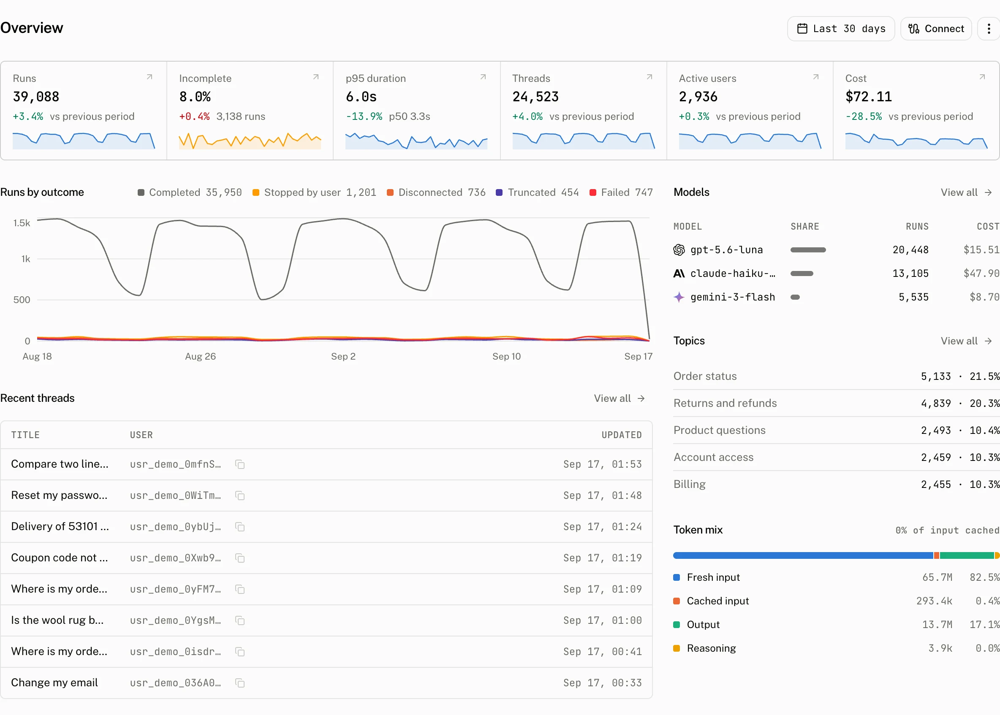
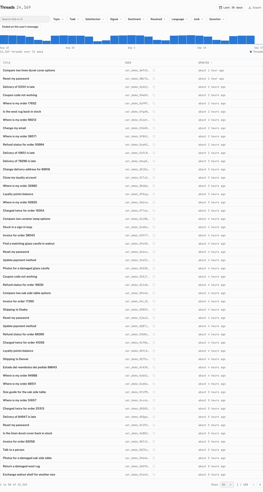
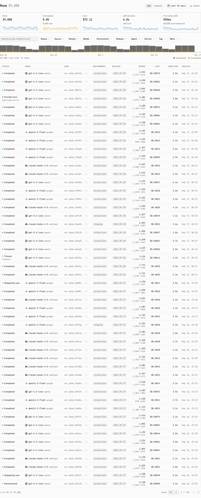
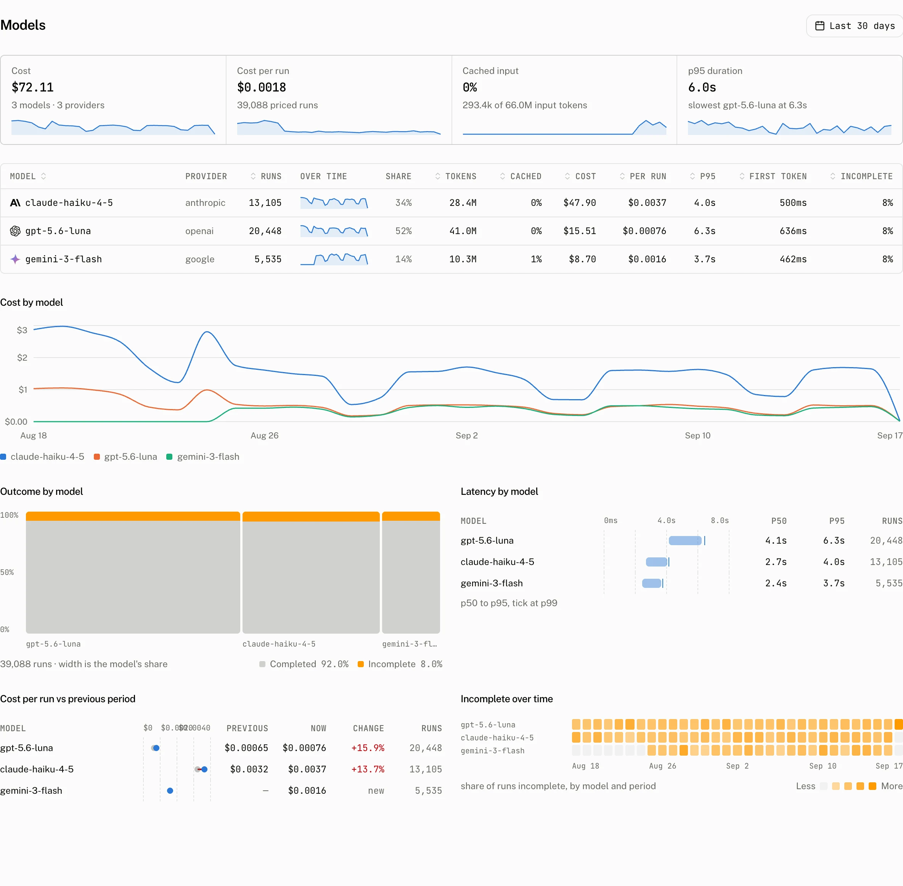

The dashboard at [cloud.assistant-ui.com](https://cloud.assistant-ui.com) turns what the SDK and your server sent to a project into pages. Every page covers one date range, every filter is part of the URL so a view can be sent as a link, and every thread, run, model or user it mentions links to its own page. The [demo project](https://cloud.assistant-ui.com/demo) is open without an account, so you can follow this page there.



| Page | The question it answers |
|---|---|
| [Overview](#overview) | How is the assistant doing over this range? |
| [Threads](#threads) | What did people talk about, and how did each conversation go? |
| [Runs](#runs) | How did each response go, and what did it cost? |
| [Models](#models) | What does each model cost and how does it behave? |
| [Users](#users) | Who uses it, and do they come back? |
| [Engagement](#engagement) | What do people do around the answers? |
| [Intelligence](#intelligence) | What do they ask, and where does the assistant fall short? |

The sidebar also holds Build, in preview: [Harnesses](/docs/cloud/harnesses), [Assistants](/docs/cloud/assistants) and [LLM providers](/docs/cloud/llm-providers); and the project's [Settings](/docs/cloud/settings) and [Billing](/docs/cloud/settings/billing). ⌘K or Ctrl+K opens the jump box, which finds pages and records by name or id and takes requests such as `open run run_123`.

## Ranges, filters and time

- **Ranges.** Every page reads one date range from the URL. Tiles compare the range with the previous range of the same length, and charts draw it in buckets the span decides, from days down to seconds. Overview, Runs and Models default to the last 30 days, Intelligence to 28, and Usage to the current month. Clicking a bar of a page's volume strip narrows the list to that bucket.
- **Filters.** A list page has one filter bar: search, then facets with counts for the range, then range facets under **More**. Tables page at 25, 50 or 100 rows. Threads, Runs and Users can [export](#exports) the current view.
- **Time.** Figures are computed in UTC days and months and shown in your browser's zone, so a figure that disagrees with your own logs is usually a zone difference.

| Owners and admins only | Every member |
|---|---|
| Allowed origins, the renderer URL, data retention, alert rules, the audit log, **Upgrade** and **Open Stripe portal** | Reading every page, API keys, auth rules, LLM providers, assistants, harnesses, feature settings, model prices, scores and the project's name, slug and icon |

Every write is recorded in the [audit log](/docs/cloud/settings/audit-log), never with a secret.

## Overview

Overview summarises the range before you open a list. Each tile opens the list behind it with the range kept.

| Tile | Reading | Opens |
|---|---|---|
| **Runs**, **Incomplete**, **p95 duration** | Total runs, the share that did not complete, and the duration 95% of runs finished under (p50 too) | Runs |
| **Cost** | Total run cost | Billing usage |
| **Threads**, **Active users** | Threads and distinct users with activity in the range | Threads, Users |
| **Rated threads**, **Thumbs down** | Threads with any rating, and with a thumbs down | Threads, filtered by feedback |

**Runs by outcome** sorts every run into one bucket. The same buckets appear on Runs and Models.

| Bucket | Stored value |
|---|---|
| **Completed** | `status: "completed"` |
| **Stopped by user** | `outcome_type: "aborted"` |
| **Disconnected** | `outcome_type: "disconnected"` |
| **Truncated** | `outcome_type: "length"` or `"content_filter"` |
| **Failed** | Any other `outcome_type` |
| **Incomplete, no reason** | No `outcome_type` |

The chart marks configuration changes, such as a thread title setting, a retention change, a provider added or a model price set, in the bucket where they happened. **Recent threads**, **Topics** and the model share sit below.

## Threads

Threads lists every conversation in the range, archived ones included, so a figure that links here opens exactly that many rows. Search matches titles and message text. Rows show topic, user, tokens and cost, with thumbs and the latest review verdict beside the title.



The facets that are always shown are **Feedback** (`positive`, `negative`, `any`), **Review** (`unreviewed`, `reviewed`, `good`, `needs_work`, `unclear`), **Satisfaction**, **Signal** and **Ended on the user's message**. Topic, task, question, sentiment, resolved, language, junk and environment appear when the range has values for them.

**Signal** selects threads by what people did or what analysis found:

| Value | Reading |
|---|---|
| `stopped`, `regenerated`, `copied`, `edited` | A `run_stopped`, `message_regenerated`, `message_copied` or `message_edited` event |
| `attachment`, `suggestion`, `branch` | An `attachment_added`, `suggestion_clicked` or `branch_switched` event |
| `approved`, `rejected`, `error` | A `tool_approved`, `tool_rejected` or `error_shown` event |
| `no_reply`, `loop` | Analysis found no assistant message, or a repeated or rephrased turn |

**Satisfaction** reads ratings first and behaviour second. A thumbs rating from an end user is never a review.

```text
positive = thumbs_up OR (NOT thumbs_down AND (copied OR run_count >= 2))
negative = thumbs_down OR (NOT thumbs_up AND (stopped OR regenerated OR edited))
satisfied = positive AND NOT negative      mixed = positive AND negative
dissatisfied = negative AND NOT positive   none = neither
```

**Review**, next to **List**, is for people on your team: it reports how many threads in the selection have a verdict, how verdicts agree with end users' thumbs, and walks unreviewed threads one by one. Verdicts are **Good**, **Needs work** or **Unclear**, with `g`, `n` and `u` as shortcuts.

<AnchorAlias id="inspect-one-thread" />

A thread's page draws the conversation, either the dashboard's own drawing or your app's ([Conversation views](/docs/cloud/dashboard/conversation-views)), with end users' thumbs and comments under the messages they rated. The rail has **Details** (ids, how the thread got its title, environment, release, tags, metadata, satisfaction and analysis), **Turns** (each question with the run that answered it), **Activity** (engagement events), **Review** and **Raw** (the stored messages as JSON). [Thread titles](/docs/cloud/thread-titles) explains every title state.

## Runs

Runs lists every response report. Search matches run, thread and user ids and error messages; facets cover status (`completed`, `incomplete`, `error`), source (`client`, `server`, `system`), reason, model, environment, release, agent, service, tag, cost and duration. Runs the cloud makes for itself, such as titles, have source `system` and are left out of the tiles and charts.



**Analysis**, next to **List**, applies the same filters to latency percentiles, duration and first-token histograms, outcome share over time, tool call aggregates, and tables by release and by model.

A run's page has **Trace**, **Conversation**, **Scores** and **Raw** tabs, a usage bar split into fresh input, cached input, output and reasoning, and the run's attributes. The trace waterfall gives every stored span a row with its input and output messages, timing, tokens and cost. Set a **Trace link template** in [Settings](/docs/cloud/settings#telemetry) to turn each trace id into a link to your own trace backend.

<AnchorAlias id="no-model-reported" />

A run under **No model reported** came from a browser report that did not carry a model id; the browser stream has no model or usage unless the route sends them. Return them from the AI SDK route's `messageMetadata`, and every later run names its model:

```ts title="app/api/chat/route.ts (abridged)"
const model = openai("gpt-6-luna");
const result = streamText({ model, messages: await convertToModelMessages(messages) });

return result.toUIMessageStreamResponse({
  messageMetadata: ({ part }) => {
    if (part.type === "finish") {
      return { usage: part.totalUsage, finishReason: part.finishReason };
    }
    if (part.type === "finish-step") {
      return { modelId: part.response.modelId, provider: model.provider };
    }
    return undefined;
  },
});
```

[Run reports](/docs/cloud/run-reports#messagemetadata-values) lists every key the callback can return. Runs executed by a server assistant carry the model already.

## Models

Models compares the models your app used. Each row is one catalog model and provider pair, and the spellings clients reported for it fold into that row as subrows, so a provider-specific id does not split its aggregate. Columns cover runs, share, tokens, cached share, cost, cost per run, p95 duration, first token and incomplete rate.



A model is **Unpriced** when the catalog has no price for it and no [model price override](/docs/cloud/settings/model-prices) matches; a cost the report itself carries (`cost_usd` or `cost_details`) wins over both. A model's page shows its runs, providers, the price it was **Priced as**, the reported ids, its topics and the tools it calls. Sampling calls inside a tool count their tokens and cost to the sampled model without adding a run.

## Users

Users counts **Active**, **New** and **Returning** users in the range and lists the people behind them, by display name when the identity carried a Name claim and by user id otherwise. Charts show new and returning users per day, weekly retention, and runs and cost per user.

A user's page reads a fixed last 30 days, whatever the range picker says, with a year of daily activity below.

The Users page and billing count active users differently: billing counts an end user once per UTC calendar month in which they sent a message, so someone can appear in one and not the other. Users cannot be deleted here; erase a user with the [project user API](/docs/cloud/api/users) and an API key.

## Engagement

Engagement turns the [events](/docs/cloud/engagement) the assistant-ui cloud client sends into readings, without recording message text.

| Tile | Reading |
|---|---|
| **Answered**, **Continued** | Threads that got an answer, and threads with a second turn |
| **Stopped**, **Regenerated**, **Copied** | Each as a share of sends |
| **Came back** | Users who returned on another day |

Below them: the **Feedback** block (rated threads, thumbs, the latest thumbs down with comments), a conversation funnel, satisfaction over time and by model and topic (the [rule](#threads) from Threads), the interaction mix of sends, edits, regenerations, copies and stops, and **Features used**:

| Feature | Event |
|---|---|
| Attachments, attachment failures | `attachment_added`, `attachment_failed` |
| Suggestions | `suggestion_clicked`, with `suggestions_shown` for impressions |
| Branching, thread switching | `branch_switched`, `thread_switched` |
| Tool approvals and rejections | `tool_approved`, `tool_rejected` |
| Read aloud, voice | `speech_started`, `voice_started` |
| Errors shown | `error_shown` |

A row that stays at zero means its action has not sent its event in the range; update the client or exercise the action through the assistant-ui components.

## Intelligence

Intelligence shows what the [analysis](/docs/cloud/intelligence) found in conversations: what people ask for and where the assistant falls short. It is on paid plans, opens on the last 28 days, and states which conversations and which analysis run its figures cover.

| Tile | Reading |
|---|---|
| **Analysed**, **Junk** | Conversations processed in the range, and the share stored as junk and left out of classification |
| **No reply**, **Loops** | Named conversations with no assistant message, or with a repeated or rephrased turn |
| **Unanswered**, **Resolved** | Conversations with an unanswered question, or a resolved outcome |

**Topics** and **Tasks** compare the named groups by threads, share, trend, no reply, loops, unanswered, depth, users, resolution and thumbs down rate; tasks also read as **Consistent**, **Mixed** or **Inconsistent**. Below them are unanswered questions, sentiment, resolution and language mixes, and [evaluator](/docs/cloud/evaluators) verdicts.

Every figure opens Threads with the range kept and a filter added: `topic`, `task`, `question`, `junk`, `sentiment`, `resolved`, `language`, or `signal=no_reply` and `signal=loop`; a thumbs down rate adds `feedback=negative`. **Ended on the user's message** on Threads is a different reading from the analysis's unanswered question.

A task's page lists what went wrong, from thumbs down comments and **Needs work** review notes, and drafts a skill: a name, when to use it and instructions. A person edits it and presses **Publish**, and a backend reads published skills with [`GET /v1/projects/skills`](/docs/cloud/api/project#list-project-skills). **Analysis runs** is the ledger of the hourly passes, with their scanned conversations, junk, model and cost.

## Exports

On Pro, Startup and Enterprise plans, Threads, Runs and Users have an **Export** control that downloads the current view, with its range to the second and its filters, as CSV or JSONL. CSV escapes a value that starts with `=`, `+`, `@` or `-` with a leading apostrophe so a spreadsheet does not run it; JSONL writes one object per line, and a Threads export nests each thread's messages. Files stream in pages of 500 rows and are named `threads_{utcDay}`, `runs_{utcDay}` or `users_{utcDay}`.

| Export | Fields |
|---|---|
| Threads | `id`, `workspace_id`, `created_by`, `created_at`, `updated_by`, `updated_at`, `title`, `last_message_at`, `is_archived`, `external_id`, `metadata`, `run_count`, `cost_usd`, `total_tokens`, `feedback_positive`, `feedback_negative`, `topic`, `task`, `review`, `review_note` |
| Runs | `id`, `project_id`, `assistant_id`, `thread_id`, `created_by`, `created_at`, `source`, `model_id`, `provider`, `input_tokens`, `cached_input_tokens`, `output_tokens`, `reasoning_tokens`, `duration_ms`, `cost_usd`, `usage_details`, `cost_details`, `status`, `outcome_type`, `error_code`, `error`, `total_steps`, `trace_id`, `message_id`, `user_message_id`, `environment`, `release`, `tags`, `metadata`, `agent_name`, `service_name`, `attributes` |
| Users | `user_id`, `name`, `threads`, `runs`, `tokens`, `cost`, `last_active` |

A Runs export leaves out system runs unless `source=system` is set. Every page of a download is recorded in the audit log. For a repeated, programmatic read, use the [project read API](/docs/cloud/api/project) with an API key instead.

## When a figure is missing

| What you see | Why | What to do |
|---|---|---|
| A page or tile is empty | The range has no stored activity of that kind | Pick a range with runs or conversations; for engagement, send events from an assistant-ui cloud client |
| Runs under **No model reported** | The report carried no model id | Return it from `messageMetadata`, [above](#no-model-reported) |
| Cost is `0`, `—` or **Unpriced** | The run has no `cost_usd` and no catalog price or override matches its model | Add a [model price override](/docs/cloud/settings/model-prices), or send the cost with the report |
| A run has no thread | Its trace's `gen_ai.conversation.id` did not resolve to a thread, or the report had no `thread_id` | See [Traces](/docs/cloud/traces) |
| A run has no spans | The report omitted `steps` and no server trace was exported | Send steps, or export the server trace |
| Analysis reads *Not analysed yet* | Intelligence is off, the thread is newer than the last pass, or it was stored as junk | Check Intelligence in Settings, or queue **Run now** |
| A user page reads *User not found* | The id has no usage in the last 30 days | Open a user with recent activity |
| No **Export** button | The plan does not include exports | Upgrade to Pro, Startup or Enterprise |
