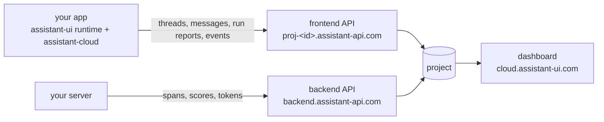

Assistant Cloud is the hosted backend for assistant-ui apps. The runtime in your app talks to it directly: threads and messages are stored as the conversation streams, every assistant response is reported with its timing, tokens, tools and outcome, and what users do around the answers is recorded as events. Your server adds the inside view by exporting its model and tool spans. The [dashboard](https://cloud.assistant-ui.com) turns all of it into pages you can read, and this book describes every one of those pages, every setting behind them, and every call the SDK makes.

## What you get

| Capability | What it means | Where it is described |
|---|---|---|
| Persistence | Threads and messages, stored as they stream, resumed across sessions and devices, listed per user, archived and deleted | [Threads](/docs/cloud/threads), [Messages](/docs/cloud/messages) |
| Titles | A model names each conversation from its first message | [Thread titles](/docs/cloud/thread-titles) |
| Run reports | Status, outcome, error, duration, time to first token, steps, tool calls, tokens, model, provider and cost for every response | [Run reports](/docs/cloud/run-reports) |
| Traces | An OpenTelemetry receiver that joins your server's spans to the browser's report | [Traces](/docs/cloud/traces) |
| Engagement | Sends, stops, edits, regenerations, copies and more, recorded without message text, plus thumbs and the scores your own code writes | [Engagement events](/docs/cloud/engagement), [Feedback and scores](/docs/cloud/scores) |
| Intelligence | Topics, tasks, unanswered questions, sentiment and resolution, judged by a model of your choice | [Intelligence](/docs/cloud/intelligence), [Evaluators](/docs/cloud/evaluators) |
| The dashboard | Overview, Threads, Runs, Models, Users, Engagement and Intelligence over any range, with alerts, exports and an audit log | [Using the dashboard](/docs/cloud/dashboard) |

## How it fits together

A project has two hosts. The frontend API answers the browser with an anonymous session or a token from your auth provider; the backend API answers your server with an API key: minting tokens, receiving traces, writing scores, reading the project. The `assistant-cloud` package is the client for both, and the assistant-ui runtimes drive it for you. [Concepts](/docs/cloud/concepts) names every object once, and [Authentication](/docs/cloud/authorization) follows a request through the API.

## Pick your integration

| You use | The cloud adds | Guide |
|---|---|---|
| The AI SDK through `useChatRuntime`, including Mastra agents | Thread list, persistence, titles, run reports, engagement, feedback, attachments | [AI SDK](/docs/cloud/ai-sdk) |
| Your own backend through `useLocalRuntime` or `useDataStreamRuntime` | The same, over any chat model adapter | [Local runtime](/docs/cloud/local-runtime) |
| LangGraph, LangChain or Google ADK | Thread list, copied settled messages, feedback and engagement; the backend remains the transcript source, and `telemetry: { messages: false }` keeps copies out | [LangGraph, LangChain and ADK](/docs/cloud/langgraph) |
| AG-UI or A2A | Everything, by composing the thread list yourself | [Custom thread list](/docs/cloud/custom-thread-list) |
| A server without a browser: a bot, an agent, a batch job | Threads, messages, titles and run reports through the client with an API key | [Servers and bots](/docs/cloud/servers) |
| A backend in another language, or a framework with OpenTelemetry | Runs, steps, tool calls and models from exported spans, or the REST API directly | [Traces](/docs/cloud/traces), [REST API](/docs/cloud/api) |
| The Cloud AI SDK, `useCloudChat` | Nothing new: the package is deprecated, its last release keeps working, and the runtime replaces it | [Migrate from Cloud AI SDK](/docs/cloud/migrate-cloud-ai-sdk) |

[Which runtime](/docs/cloud/runtimes) is the full matrix of what each integration stores and reports. The runtime guides work on React, React Native and Ink: the packages are the same, only the environment differs.

## How the book is organised

| Section | What it holds |
|---|---|
| [Authentication and access](/docs/cloud/authorization) | The three ways a client proves who it is, the rules a project enforces, and who the user and the workspace are |
| [Conversations](/docs/cloud/threads) | Threads, messages and their formats, titles, attachments and retention |
| [Integrations](/docs/cloud/runtimes) | One guide per runtime, servers and bots, the migration from the Cloud AI SDK, and the upgrade from `assistant-cloud` 0.1 |
| [Telemetry](/docs/cloud/run-reports) | Run reports field by field, traces and the receiver's rules, engagement events, feedback and scores |
| [Cloud features](/docs/cloud/llm-providers) | The features the cloud runs on your conversations with a model: providers, intelligence, evaluators, assistants and harnesses |
| [Dashboard](/docs/cloud/dashboard) | Every page of the dashboard with every figure defined |
| [Settings](/docs/cloud/settings) | Every settings page, who may change it, alerts, the audit log and billing |
| [Reference](/docs/cloud/api) | The REST API route by route, the client, the stored formats and every limit |

Every page follows the same order: what the feature is, how it works, every control with its default and bound, the calls from your code, what it costs, and a troubleshooting table of what you see, why, and what to do.

The [demo project](https://cloud.assistant-ui.com/demo) is open without an account: a retailer's synthetic support assistant that gains an hour of conversations every hour, with every page of the dashboard read only. The screenshots in this book were taken there.

An app on `assistant-cloud` 0.1 starts with [Upgrade from 0.1](/docs/cloud/upgrade-from-0-1).

## Every page

{/* section-index:start. Generated from meta.json and each page's title and description by `pnpm generate:section-indexes`; edit those, not this list. */}

<Cards>
  <Card title="Quickstart" href="/docs/cloud/quickstart">From an empty project to a persisted, reported and titled conversation in the dashboard, and what to check when the first turn does not show up.</Card>
  <Card title="Concepts" href="/docs/cloud/concepts">The objects a project holds, how a request names the user and the workspace it acts for, and what the SDK sends during one turn of a conversation.</Card>
  <Card title="Plans and pricing" href="/docs/cloud/pricing">What each plan includes, how active users are counted, and what happens at the cap.</Card>
</Cards>

### Authentication and access

<Cards>
  <Card title="Authentication" href="/docs/cloud/authorization">Choose an Assistant Cloud client mode, follow a request through authentication, and understand the errors the API returns.</Card>
  <Card title="Anonymous sessions" href="/docs/cloud/anonymous-sessions">Give a browser visitor a cloud identity before sign in, keep its threads for 30 days, and claim them after authentication.</Card>
  <Card title="Auth providers" href="/docs/cloud/auth-providers">Trust external JWT issuers with auth rules, exchange their tokens in the browser, and mint cloud tokens from a server when needed.</Card>
  <Card title="API keys" href="/docs/cloud/api-keys">Create, use, monitor, and revoke a server side API key for Assistant Cloud.</Card>
  <Card title="Allowed origins" href="/docs/cloud/allowed-origins">Control which browser origins can reach a project's frontend API host through CORS.</Card>
  <Card title="Users and workspaces" href="/docs/cloud/users-and-workspaces">Decide how Assistant Cloud identifies a user, choose the workspace that owns their threads, and manage user visibility and erasure.</Card>
</Cards>

### Conversations

<Cards>
  <Card title="Threads" href="/docs/cloud/threads">How an app creates, loads, updates, archives and deletes cloud conversations, and how those conversations appear in the dashboard.</Card>
  <Card title="Messages" href="/docs/cloud/messages">How Assistant Cloud stores conversation trees, converts message formats, persists runtime history and records message feedback.</Card>
  <Card title="Thread titles" href="/docs/cloud/thread-titles">A model names each conversation that has a user message, from that message. How a title is made, every setting behind it, what it costs, and why a thread stays Untitled.</Card>
  <Card title="Attachments" href="/docs/cloud/attachments">Upload images and documents from the composer, send them as message parts, and read them through short lived signed URLs.</Card>
  <Card title="Retention" href="/docs/cloud/retention">Choose how long Assistant Cloud keeps conversation data, schedule shorter windows safely, and understand what remains for reporting.</Card>
</Cards>

### Integrations

<Cards>
  <Card title="Which runtime" href="/docs/cloud/runtimes">What every assistant-ui runtime stores in the cloud and reports to it, what each cannot, and how the three platforms differ.</Card>
  <Card title="AI SDK" href="/docs/cloud/ai-sdk">Connect the AI SDK runtime to Assistant Cloud for persisted threads, titles, run reports, engagement, feedback and attachments.</Card>
  <Card title="Local runtime" href="/docs/cloud/local-runtime">Give any backend Assistant Cloud threads, persistence, titles and run reports through useLocalRuntime, or compose the cloud thread list around a runtime of your own.</Card>
  <Card title="LangGraph, LangChain and ADK" href="/docs/cloud/langgraph">Add an Assistant Cloud thread list, a copy of the conversation, feedback and engagement events to runtimes whose backend owns the conversation.</Card>
  <Card title="Custom thread list" href="/docs/cloud/custom-thread-list">Compose a Cloud backed thread list around a runtime, adapter or message format of your own.</Card>
  <Card title="Servers and bots" href="/docs/cloud/servers">Store bot conversations, report model work and read an Assistant Cloud project from a backend with an API key.</Card>
  <Card title="Migrate from Cloud AI SDK" href="/docs/cloud/migrate-cloud-ai-sdk">@assistant-ui/cloud-ai-sdk, the Cloud AI SDK, is deprecated. The last published version keeps working; new work moves to the assistant-ui runtime or builds on the assistant-cloud client directly.</Card>
  <Card title="Upgrade from 0.1" href="/docs/cloud/upgrade-from-0-1">Move an app from assistant-cloud 0.1 to the 0.2 line the assistant-ui runtimes depend on, and turn on what 0.2 reports.</Card>
</Cards>

### Telemetry

<Cards>
  <Card title="Run reports" href="/docs/cloud/run-reports">The report sent for an assistant response, its limits and outcomes, and how it becomes a run in Assistant Cloud.</Card>
  <Card title="Traces" href="/docs/cloud/traces">Send server model and tool spans to Assistant Cloud, map them to runs, and merge them with a browser report.</Card>
  <Card title="Engagement events" href="/docs/cloud/engagement">Record the actions users take around an answer, how events reach Assistant Cloud, and how the dashboard turns them into engagement signals.</Card>
  <Card title="Feedback and scores" href="/docs/cloud/scores">Collect message thumbs and write, read, and inspect named scores for threads, messages, and runs.</Card>
</Cards>

### Cloud features

<Cards>
  <Card title="LLM providers" href="/docs/cloud/llm-providers">Connect the model accounts that Assistant Cloud features use for generation, analysis, and evaluation.</Card>
  <Card title="Intelligence" href="/docs/cloud/intelligence">Classify conversations into topics, tasks, questions, and signals with a model you choose.</Card>
  <Card title="Evaluators" href="/docs/cloud/evaluators">Define model judges that write structured verdicts for sampled conversations.</Card>
  <Card title="Assistants" href="/docs/cloud/assistants">Configure a stored provider and model, then run it from a cloud thread.</Card>
  <Card title="Harnesses" href="/docs/cloud/harnesses">Run an AI SDK endpoint at a dedicated cloud origin while keeping conversations in Assistant Cloud.</Card>
</Cards>

### Dashboard

<Cards>
  <Card title="Dashboard" href="/docs/cloud/dashboard">What each page of the dashboard at cloud.assistant-ui.com answers, what its figures mean, and where a missing figure is fixed.</Card>
  <Card title="Conversation views" href="/docs/cloud/dashboard/conversation-views">How the thread page draws what each runtime stores, and how to show a conversation with your own components.</Card>
</Cards>

### Project settings

<Cards>
  <Card title="Settings" href="/docs/cloud/settings">Every settings page of a project, what General and Telemetry hold, who may change what, and where each other setting is documented.</Card>
  <Card title="Model prices" href="/docs/cloud/settings/model-prices">Override model prices for stored runs and find model IDs the catalog cannot price.</Card>
  <Card title="Alerts" href="/docs/cloud/settings/alerts">Watch a project metric once an hour and receive a signed webhook when it is above a threshold.</Card>
  <Card title="Audit log" href="/docs/cloud/settings/audit-log">See the configuration and data changes made in a project, who viewed or exported conversations, and when.</Card>
  <Card title="Billing and usage" href="/docs/cloud/settings/billing">Read the current plan, active user allowance and usage projection, then break the billing period down by day, model and user.</Card>
</Cards>

### REST API

<Cards>
  <Card title="Conventions" href="/docs/cloud/api">The hosts, credentials, headers, ids, paging rules and error shapes every route of the project API shares, and the index of routes.</Card>
  <Card title="Auth tokens" href="/docs/cloud/api/auth-tokens">Mint short lived access tokens for trusted backends and anonymous visitors.</Card>
  <Card title="Threads" href="/docs/cloud/api/threads">Create, list, read, update, archive and delete threads, and claim an anonymous visitor's threads after sign in.</Card>
  <Card title="Messages" href="/docs/cloud/api/messages">Create, read, delete, update, and score the messages in a thread.</Card>
  <Card title="Runs" href="/docs/cloud/api/runs">Record completed, incomplete, or failed model runs and start streamed assistant runs.</Card>
  <Card title="Events" href="/docs/cloud/api/events">Record text-free engagement events and update a project's daily rollups and thread signals.</Card>
  <Card title="Scores" href="/docs/cloud/api/scores">Record numeric, categorical and boolean scores against a thread, message or run.</Card>
  <Card title="Files" href="/docs/cloud/api/files">Generate signed upload and download URLs for project attachments.</Card>
  <Card title="Traces" href="/docs/cloud/api/traces">Receive OTLP traces and map GenAI spans into runs, steps and tool calls.</Card>
  <Card title="Project read API" href="/docs/cloud/api/project">Read project runs, usage, threads and scores from a backend with an API key.</Card>
  <Card title="Users" href="/docs/cloud/api/users">Erase a user's project data through the project wide API.</Card>
  <Card title="MCP" href="/docs/cloud/api/mcp">Connect an MCP client to Assistant Cloud project reads.</Card>
</Cards>

### Reference

<Cards>
  <Card title="The assistant-cloud client" href="/docs/cloud/sdk">Construct the Assistant Cloud client, choose authentication, and use its namespaces.</Card>
  <Card title="Stored message formats" href="/docs/cloud/formats">The message formats Assistant Cloud stores, converts, and reads for thread titles.</Card>
  <Card title="Limits" href="/docs/cloud/limits">Every limit a project enforces, in one place.</Card>
</Cards>

{/* section-index:end */}
