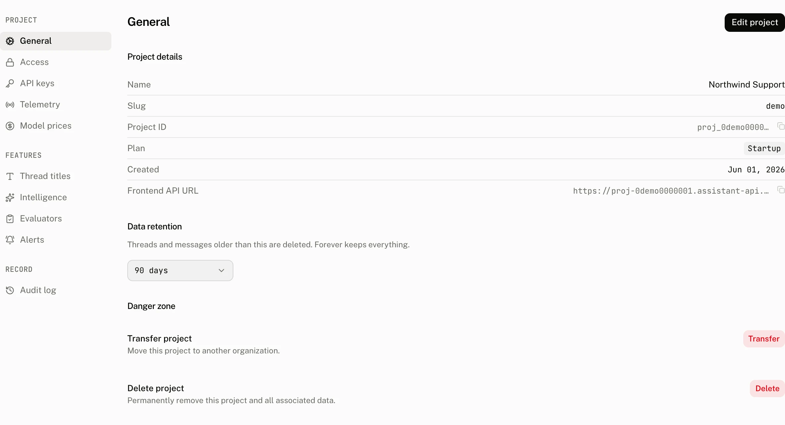
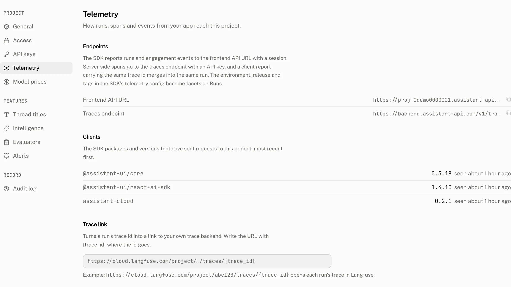

Settings apply per project and are grouped into Project, Features and Record. Settings that belong to a topic are documented with that topic; General and Telemetry are documented on this page.

| Group | Page | What it holds | Documented on |
|---|---|---|---|
| Project | General | Name, slug, id, plan, Frontend API URL, retention, transfer and deletion | [General](#general), [Retention](/docs/cloud/retention) |
| Project | Access | Anonymous access, allowed origins, auth rules | [Anonymous sessions](/docs/cloud/anonymous-sessions), [Allowed origins](/docs/cloud/allowed-origins), [Auth providers](/docs/cloud/auth-providers) |
| Project | API keys | Server keys with their expiry and last use | [API keys](/docs/cloud/api-keys) |
| Project | Telemetry | Endpoints, trace link, renderer URL, SDK clients seen | [Telemetry](#telemetry) |
| Project | Model prices | Price overrides and the month's unpriced models | [Model prices](/docs/cloud/settings/model-prices) |
| Features | Thread titles, Intelligence, Evaluators | The model work the cloud does on conversations | [Thread titles](/docs/cloud/thread-titles), [Intelligence](/docs/cloud/intelligence), [Evaluators](/docs/cloud/evaluators) |
| Features | Alerts | Hourly metric rules that deliver a signed webhook | [Alerts](/docs/cloud/settings/alerts) |
| Record | Audit log | Every change, and who viewed or exported conversations | [Audit log](/docs/cloud/settings/audit-log) |

Billing and Usage sit under Project in the sidebar and are on [Billing](/docs/cloud/settings/billing). Owners and admins alone may change allowed origins, the renderer URL, data retention and alert rules, read the audit log, and upgrade or open the Stripe portal; every member may change the rest. Every write goes to the audit log with its changed fields and never a secret. The demo project refuses every change.

## General

General shows the project's name, slug, id, plan, creation time and **Frontend API URL**, the browser endpoint, formed as `https://{project id with its first _ replaced by -}.assistant-api.com`.

**Edit project** changes the name (4 to 255 characters), the slug (4 to 32 lowercase letters, digits and single hyphens, starting with a letter and ending with a letter or digit), the icon (up to 8 characters) and the colour (`#` and six hex digits). Renaming the slug moves the settings page to the new address, so update saved links. Owners and admins set [data retention](/docs/cloud/retention) here, and can cancel a scheduled shorter period before it takes effect. **Transfer project** and **Delete project** go through support after you type the project name, and for deletion `CONFIRM DELETE`.

## Telemetry

Telemetry holds the endpoints the project receives on, links stored traces to your own trace backend, names the page that draws a conversation as your users saw it, and lists the SDK versions that send requests.

| Setting | What it does |
|---|---|
| Frontend API URL | Where browser SDKs send runs and engagement events, with a session |
| Traces endpoint | Where a server sends spans with an API key: `https://backend.assistant-api.com/v1/traces`, or `{origin}/v1/traces` for a project on another origin. A browser report and a server span with the same trace id merge into one run. |
| **Trace link template** | A URL with the literal `{trace_id}`, up to 512 characters, such as `https://cloud.langfuse.com/project/abc123/traces/{trace_id}`. A run's **Trace id** becomes a link to it. |
| **Renderer URL** | A page of your app that mounts `CloudRendererHost`, so a thread can be shown **As shown** next to **Structured**; see [Conversation views](/docs/cloud/dashboard/conversation-views). It must be `https`, or `http` on `localhost` or `127.0.0.1`, with no credentials or wildcard host, up to 2,048 characters. Owners and admins set it. |
| **Clients** | Each SDK name and version that sent an `Aui-Sdk` header, most recent first, recorded at most once per 10 minutes and dropped after 180 days unseen. Use it to find apps on an old SDK. |
