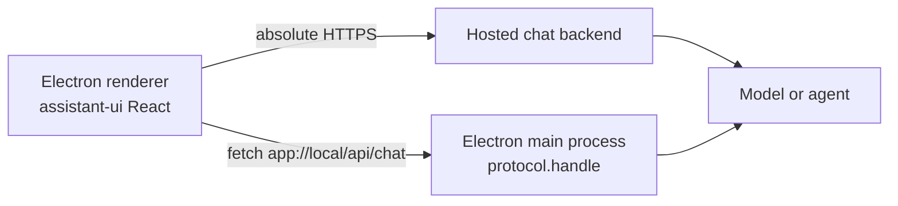

assistant-ui works in Electron through `@assistant-ui/react`. The renderer is a React DOM environment, so there is no separate `@assistant-ui/electron` package to install. The Electron-specific decision is where model requests run and how the renderer reaches them.

<Callout type="warn">
  Never put a provider API key in renderer code, a `VITE_*` variable, or a preload script. Bundled values are readable by anyone with the app. Keep remote credentials on your backend, or keep local credentials in the main process and provision them with an OS-backed secret store.
</Callout>

## Choose a connection pattern

| Pattern | Use it when | Runtime |
| --- | --- | --- |
| Hosted backend | You already have an AI SDK endpoint, need server auth or persistence, or ship the app to other people | `useChatRuntime` with an absolute HTTPS URL |
| Local main process | The desktop app owns the provider or agent process and must work without your web backend | `useChatRuntime` with a route served by `protocol.handle` |



## Pattern 1: hosted backend

This is the smallest integration. Keep your existing AI SDK chat route and point `AssistantChatTransport` at its public URL.

```tsx title="renderer/assistant-runtime.tsx"
import type { ReactNode } from "react";
import { AssistantRuntimeProvider } from "@assistant-ui/react";
import {
  AssistantChatTransport,
  useChatRuntime,
} from "@assistant-ui/ai-sdk";

const transport = new AssistantChatTransport({
  api: "https://api.example.com/chat",
});

export function ElectronRuntimeProvider({ children }: { children: ReactNode }) {
  const runtime = useChatRuntime({ transport });

  return (
    <AssistantRuntimeProvider runtime={runtime}>
      {children}
    </AssistantRuntimeProvider>
  );
}
```

The URL must be absolute in a packaged app. A relative value such as `/api/chat` targets the renderer's `file://` or custom-protocol origin, not your deployed backend. Configure the backend's CORS policy for the packaged origin, allow the endpoint in `connect-src`, and authenticate requests as you would from any desktop client.

The endpoint must return the AI SDK UI message stream consumed by `AssistantChatTransport`. See the [AI SDK runtime guide](/docs/runtimes/ai-sdk/v7) for the backend route and tool-calling setup.

## Pattern 2: local main process

Use this pattern when the desktop app calls the model itself and must work without your web backend. Electron's [`protocol.handle`](https://www.electronjs.org/docs/latest/api/protocol#protocolhandlescheme-handler) answers renderer `fetch` calls with a `(Request) => Response` handler, so the main process runs the same AI SDK route a web app would, and the renderer keeps `AssistantChatTransport`. It needs no preload script or IPC messages. The renderer gets the full UI message stream, so tool calls, reasoning, and attachments work as they do on the web.

This pattern needs Electron 44.4 or later (or 43.7 and later on the 43 line), the first releases that set `request.initiatorOrigin` on protocol requests.

### 1. Serve the renderer and the route from one scheme

```ts title="main/main.ts"
import path from "node:path";
import { pathToFileURL } from "node:url";
import { app, BrowserWindow, net, protocol, session } from "electron";
import { POST } from "./api/chat";

protocol.registerSchemesAsPrivileged([
  {
    scheme: "app",
    privileges: { standard: true, secure: true, supportFetchAPI: true },
  },
]);

const APP_ORIGIN = "app://local";
const rendererRoot = path.join(__dirname, "renderer");

function serveRenderer(url: URL) {
  const pathname =
    url.pathname === "/" ? "/index.html" : decodeURIComponent(url.pathname);
  const filePath = path.join(rendererRoot, pathname);
  if (!filePath.startsWith(rendererRoot + path.sep)) {
    return new Response("Not found", { status: 404 });
  }
  return net.fetch(pathToFileURL(filePath).toString());
}

app.whenReady().then(() => {
  const assistantSession = session.fromPartition("persist:assistant");

  assistantSession.protocol.handle("app", (req) => {
    const url = new URL(req.url);
    if (url.host !== "local") return new Response("Not found", { status: 404 });
    if (url.pathname !== "/api/chat") return serveRenderer(url);

    // Set by Electron, not the page. Electron's typings don't declare it yet.
    const { initiatorOrigin } = req as Request & { initiatorOrigin?: string };
    if (req.method !== "POST" || initiatorOrigin !== APP_ORIGIN) {
      return new Response("Forbidden", { status: 403 });
    }
    return POST(req);
  });

  const mainWindow = new BrowserWindow({
    webPreferences: {
      session: assistantSession,
      contextIsolation: true,
      sandbox: true,
      nodeIntegration: false,
    },
  });
  mainWindow.loadURL(`${APP_ORIGIN}/index.html`);
});
```

- Registering `app` as a standard, secure scheme gives the renderer a real origin, `app://local`. The relative `/api/chat` URL is then same-origin, so it needs no CORS setup and survives packaging. Compare hosts rather than `url.origin`, which Node reports as `"null"` for custom schemes.
- The handler is registered on a dedicated session partition. Only windows created with that session can load `app://` at all, so keep other windows, such as ones that show external content, on the default session.
- `initiatorOrigin` comes from Electron, so a page cannot fake it the way it can set `referrer`. Without this check, any page loaded in the assistant session could post to the route, even with `mode: "no-cors"`. Requests started by the main process itself carry no initiator and are rejected too.
- `net.fetch` also reads files from inside a packaged `app.asar` archive.

### 2. Run the AI SDK route in the main process

Install the provider packages in the main-process bundle:

```sh
pnpm add ai @ai-sdk/openai
```

This is the [AI SDK route](/docs/runtimes/ai-sdk/v7) with one change. Electron builds the handler's `Request` without an abort signal, so `abortSignal: req.signal` would never fire and the model request would keep running after the user presses Stop. Instead, abort when the renderer cancels the response body, which happens on Stop, on reload, and when the window closes.

```ts title="main/api/chat.ts"
import { openai } from "@ai-sdk/openai";
import {
  convertToModelMessages,
  createUIMessageStreamResponse,
  streamText,
  toUIMessageStream,
  type UIMessage,
} from "ai";

export async function POST(req: Request) {
  const { messages }: { messages: UIMessage[] } = await req.json();

  // protocol.handle never aborts req.signal, so abort when the renderer
  // cancels the response body instead (Stop, reload, or window close).
  const abortController = new AbortController();
  const result = streamText({
    model: openai("gpt-6-luna"),
    messages: await convertToModelMessages(messages),
    abortSignal: abortController.signal,
  });

  const reader = toUIMessageStream({ stream: result.stream }).getReader();
  return createUIMessageStreamResponse({
    stream: new ReadableStream({
      async pull(controller) {
        const { done, value } = await reader.read();
        if (done) controller.close();
        else controller.enqueue(value);
      },
      cancel(reason) {
        abortController.abort(reason);
        return reader.cancel(reason);
      },
    }),
  });
}
```

Set `OPENAI_API_KEY` only in the main-process environment. Add tools, a system prompt, and other `streamText` options exactly as in a web route.

### 3. Point the renderer at the route

The renderer is the same as in Pattern 1, with a relative URL:

```tsx title="renderer/assistant-runtime.tsx"
import type { ReactNode } from "react";
import { AssistantRuntimeProvider } from "@assistant-ui/react";
import {
  AssistantChatTransport,
  useChatRuntime,
} from "@assistant-ui/ai-sdk";

const transport = new AssistantChatTransport({ api: "/api/chat" });

export function ElectronRuntimeProvider({ children }: { children: ReactNode }) {
  const runtime = useChatRuntime({ transport });

  return (
    <AssistantRuntimeProvider runtime={runtime}>
      {children}
    </AssistantRuntimeProvider>
  );
}
```

Wrap your existing assistant-ui thread with `ElectronRuntimeProvider`. Primitives and installed UI components work exactly as they do in a browser React app.

### Development server

If the window loads your dev server's URL directly, `/api/chat` resolves against `http://localhost` and never reaches the handler. Load `app://local` in development too, and have `serveRenderer` forward to the dev server:

```ts title="main/main.ts"
const devServerUrl = process.env.VITE_DEV_SERVER_URL;

function serveRenderer(url: URL) {
  if (devServerUrl) {
    return net.fetch(new URL(url.pathname + url.search, devServerUrl).toString());
  }
  // ...serve built files as above
}
```

Use whichever variable your build tool provides: Electron Forge's Vite plugin defines `MAIN_WINDOW_VITE_DEV_SERVER_URL`, and electron-vite sets `process.env.ELECTRON_RENDERER_URL`. With Vite, set `server.hmr.clientPort` to the dev server's port so the HMR client connects from `app://local`, and allow `ws://localhost:<port>` in your development CSP's `connect-src`.

## Packaged-app checklist

- Use an absolute HTTPS endpoint or a route on your own privileged scheme. A relative `/api/*` URL only works when the page itself is served from the scheme that handles it.
- Serve local content through a custom protocol instead of `file://` when possible, and define a restrictive Content Security Policy. Do not disable `webSecurity` to work around origin errors.
- Check `initiatorOrigin` on every route the main process serves, and validate request bodies there. Treat renderer data as untrusted even when the renderer is local.
- Intercept new windows and external links with `webContents.setWindowOpenHandler`; do not let model-generated links create unrestricted Electron windows.
- If you render remote HTML with `SafeContentFrame`, allow its documented host in `frame-src`. Ordinary text and Markdown rendering need no Electron-specific change.
- Test the packaged build, not only the Vite or Webpack development server. The scheme, origin, file paths inside `app.asar`, CSP, and environment loading can all differ.

For the underlying platform constraints, see Electron's [`protocol` API](https://www.electronjs.org/docs/latest/api/protocol), [context isolation](https://www.electronjs.org/docs/latest/tutorial/context-isolation), and the [security checklist](https://www.electronjs.org/docs/latest/tutorial/security).
