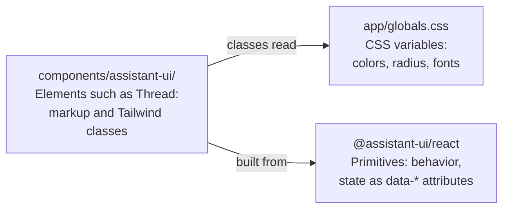

import { ThemeSwitcherSample } from "@/components/pages/docs/samples/theme-switcher.lazy";

assistant-ui has no stylesheet of its own to fight. The package handles the behavior: state, streaming, scrolling and the keyboard. The look is code in your project: CSS variables in your global stylesheet, and component files the CLI copied in. So to make the chat look like your product, you edit your own files, starting with the smallest change that does the job.

<ThemeSwitcherSample />

## Where the styles come from



- **Primitives** such as `ThreadPrimitive.Viewport` and `ComposerPrimitive.Input` come from the `@assistant-ui/react` package. They render plain elements with no styles and expose their state as `data-*` attributes.
- **Elements** such as `Thread` are styled components built from primitives. `npx assistant-ui init` sets up shadcn/ui and copies `Thread` and the files it uses into `components/assistant-ui/elements/`, and `npx assistant-ui add <name>` copies any other element. Both go through the shadcn CLI, the same way shadcn/ui copies a `Button`, so the files are yours: updating the packages doesn't overwrite them.
- **Theme variables** live in your global stylesheet. The elements' Tailwind classes, such as `bg-background` and `text-muted-foreground`, read the same shadcn/ui variables as the rest of your app.

[Components you own](/docs/concepts/components) explains the split in more depth, including what `update`, `add --overwrite` and `upgrade` do to your copies.

## Change colors, radius and fonts with CSS variables

Set CSS variables once and every element follows:

```css title="app/globals.css"
:root {
  --primary: oklch(0.55 0.17 250);
  --primary-foreground: oklch(0.985 0.01 250);
  --muted: oklch(0.94 0.025 235);
  --radius: 1rem;
}

@theme inline {
  --font-sans: "Iowan Old Style", Georgia, serif;
}
```

The elements use shadcn/ui's variable names: `--background`, `--foreground`, `--primary`, `--secondary`, `--muted`, `--accent`, `--destructive`, `--popover`, each with a `-foreground` partner for the text on it, plus `--border`, `--input`, `--ring` and `--radius`. The composer and the message bubbles are the exception for rounding: they take it from the `Thread` file, as the next section shows. A theme from your design system or from the [shadcn/ui theming guide](https://ui.shadcn.com/docs/theming) restyles the chat with the rest of your app. Fonts come from `--font-sans` and `--font-mono`: set a font stack, as above, or point them at the variable your font loader sets, as the starter does with `next/font` and `--font-inter`.

## Restyle a component you own

When variables aren't enough, edit the element. It's an ordinary React file with Tailwind classes. To put your own messages in the brand color, change one class list in your copy of `Thread`:

```diff title="components/assistant-ui/elements/thread.aui.tsx"
-        <div className="aui-user-message-content peer bg-muted text-foreground rounded-(--composer-radius) px-4 py-2 wrap-break-word empty:hidden">
+        <div className="aui-user-message-content peer bg-primary text-primary-foreground rounded-(--composer-radius) px-4 py-2 wrap-break-word empty:hidden">
```

The same file sets the thread's layout variables inline on its root: `--thread-max-width` (44rem), `--composer-radius`, `--composer-bg` and `--composer-padding`. Change them there; see [Restyle the shell](/elements/thread#restyle-the-shell). `npx assistant-ui add thread --overwrite` fetches a fresh copy and drops your edits, so commit first.

## Swap in a custom component

To replace a whole piece rather than its classes, pass your own component through the element's `components` prop. Slots you don't name keep the built-in version:

```tsx title="components/chat.tsx"
"use client";

import {
  Thread,
  type ThreadComponents,
} from "@/components/assistant-ui/elements/thread.aui";

const components: ThreadComponents = {
  Welcome: () => (
    <div className="mb-6 px-2">
      <p className="text-2xl font-semibold">Ask Acme anything</p>
      <p className="text-muted-foreground">Orders, returns and shipping.</p>
    </div>
  ),
};

export function Chat() {
  return <Thread components={components} />;
}
```

`Thread` takes `Welcome`, `AssistantMessage`, `Indicator`, `ToolFallback`, `ToolGroup`, `ReasoningGroup`, `TaskGroup` and `ComposerExtra` ([ThreadComponents](/elements/thread#threadcomponents)). Inside a message you build yourself, `MessagePrimitive.Parts` takes a `components` prop the same way, such as `Text` or `Image` ([Message](/docs/primitives/message)).

## Style by state with data attributes

Primitives mark their state with `data-*` attributes, so a Tailwind `data-*` variant or a CSS attribute selector can style it. When a state has no attribute, such as whether a message is the last one or which branch shows, read it with `useAuiState` and set your own, as `Thread` does with `data-role`:

```tsx title="components/assistant-message.tsx"
"use client";

import {
  ActionBarPrimitive,
  MessagePrimitive,
  useAuiState,
} from "@assistant-ui/react";
import { CheckIcon, CopyIcon } from "lucide-react";

export function AssistantMessage() {
  const isLast = useAuiState((s) => s.message.isLast);

  return (
    <MessagePrimitive.Root
      data-last={isLast ? "" : undefined}
      className="border-s-2 border-transparent ps-3 data-last:border-primary"
    >
      <MessagePrimitive.Parts />
      <ActionBarPrimitive.Root>
        <ActionBarPrimitive.Copy className="group data-copied:text-primary">
          <CopyIcon className="size-4 group-data-copied:hidden" />
          <CheckIcon className="hidden size-4 group-data-copied:block" />
        </ActionBarPrimitive.Copy>
      </ActionBarPrimitive.Root>
    </MessagePrimitive.Root>
  );
}
```

| Attribute | Set on | When |
| --- | --- | --- |
| `data-status` = `running`, `complete`, `incomplete` | `MessagePartPrimitive.Text`, `MarkdownTextPrimitive` | The text part's status, `running` while it streams |
| `data-copied` | `ActionBarPrimitive.Copy` | Just after a copy |
| `data-submitted` | `ActionBarPrimitive.FeedbackPositive`, `FeedbackNegative` | Feedback was given |
| `data-floating` | `ActionBarPrimitive.Root` | Floating, with `autohideFloat` |
| `data-active` | `ThreadListItemPrimitive.Root`, `ThreadListPrimitive.New` | The thread that's open |
| `data-dragging` | `ComposerPrimitive.AttachmentDropzone` | A file is dragged over it |
| `data-compact` | `ComposerPrimitive.Root` with `compact` | The input fits on one line |
| `data-run-state` = `stale`, `in-progress` | `ErrorPrimitive.Root` | Another tab or session drove the run |

Action buttons such as `ComposerPrimitive.Send` also get the `disabled` attribute when they can't act. Each [primitive's page](/docs/primitives) and its API reference describe its attributes.

## Dark mode

The dark theme is a second set of the same variables:

```css title="app/globals.css"
@custom-variant dark (&:is(.dark *));

.dark {
  --background: oklch(0.2 0.03 250);
  --foreground: oklch(0.95 0.015 230);
  --primary: oklch(0.72 0.14 235);
  --primary-foreground: oklch(0.2 0.03 250);
}
```

shadcn/ui's setup writes this block next to `:root`. It applies when an ancestor has the `dark` class, so add `class="dark"` to `<html>`, or let a library such as `next-themes` (with `attribute="class"`) set it from a toggle or the OS setting. The elements take their dark colors from these variables and use Tailwind's `dark:` variant in a few places, such as the error banner.

## Without Tailwind

Primitives don't need Tailwind. They take `className` and `style`, and `asChild` moves their behavior onto your own component, so CSS modules, plain CSS or a CSS-in-JS library all work:

```tsx title="components/plain-chat.tsx"
"use client";

import {
  ComposerPrimitive,
  MessagePrimitive,
  ThreadPrimitive,
} from "@assistant-ui/react";
import styles from "./plain-chat.module.css";

export function PlainChat() {
  return (
    <ThreadPrimitive.Root className={styles.thread}>
      <ThreadPrimitive.Viewport className={styles.viewport}>
        <ThreadPrimitive.Messages>
          {() => (
            <MessagePrimitive.Root className={styles.message}>
              <MessagePrimitive.Parts />
            </MessagePrimitive.Root>
          )}
        </ThreadPrimitive.Messages>
      </ThreadPrimitive.Viewport>
      <ComposerPrimitive.Root className={styles.composer}>
        <ComposerPrimitive.Input className={styles.input} />
        <ComposerPrimitive.Send className={styles.send}>
          Send
        </ComposerPrimitive.Send>
      </ComposerPrimitive.Root>
    </ThreadPrimitive.Root>
  );
}
```

```css title="components/plain-chat.module.css"
.message [data-status="running"]::after {
  content: "▍";
}

.send:disabled {
  opacity: 0.5;
}
```

The elements are written in Tailwind, so without it you build your own from [primitives](/docs/primitives) and read an element's source to see how the parts fit together.

## Prompt for your coding agent

```txt
Fetch https://www.assistant-ui.com/docs/guides/styling.md and restyle my assistant-ui chat to match the rest of my app: <your colors, corner radius and font>. Prefer the theme variables in my global stylesheet, keep dark mode working, and edit the copied files in components/assistant-ui/ only where variables aren't enough.
```
