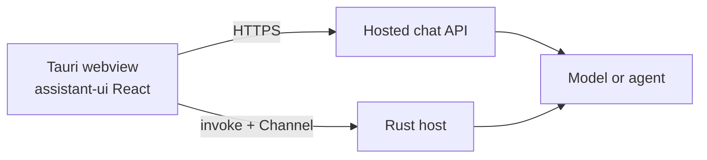

Tauri packages a web frontend and a Rust host into a desktop app. Use `@assistant-ui/react` in its webview: your existing thread, composer, and message components render through React DOM. No separate assistant-ui Tauri package is needed.

## Choose where requests run

| Pattern | Use it when | Runtime |
| --- | --- | --- |
| Hosted backend | Your app already has a chat API, authentication, or server-side persistence | `useChatRuntime` with an absolute HTTPS URL |
| Rust host | The desktop app owns model requests or a local agent | `useLocalRuntime` with a `ChatModelAdapter` |



Start with a [Tauri 2 React/Vite application](https://v2.tauri.app/start/create-project/) and follow the [Vite configuration guide](https://v2.tauri.app/start/frontend/vite/). Keep your assistant-ui components inside the runtime provider below. Both patterns use the same UI.

<Callout type="warn">
  Keep provider keys out of frontend code and `VITE_*` variables. For a distributed app, keep your service's keys on a hosted backend. A native integration can use a user's own credentials provisioned through an OS-backed secret store; embedding your service key in the Rust binary does not protect it from the person running the app.
</Callout>

## Pattern 1: hosted backend

Install `@assistant-ui/react` and `@assistant-ui/ai-sdk`. Point the transport at an existing [AI SDK chat endpoint](/docs/runtimes/ai-sdk/v7):

```tsx title="src/assistant-runtime.tsx"
import type { ReactNode } from "react";
import { AssistantRuntimeProvider } from "@assistant-ui/react";
import { AssistantChatTransport, useChatRuntime } from "@assistant-ui/ai-sdk";

const transport = new AssistantChatTransport({
  api: "https://api.example.com/chat",
});

export function TauriRuntimeProvider({ children }: { children: ReactNode }) {
  const runtime = useChatRuntime({ transport });

  return (
    <AssistantRuntimeProvider runtime={runtime}>
      {children}
    </AssistantRuntimeProvider>
  );
}
```

Use an absolute URL. A relative `/api/chat` points at the packaged application's origin, where there is no Next.js or Node server. The endpoint must return an AI SDK UI message stream, not raw provider SSE.

The request uses webview `fetch`, so configure your backend's CORS policy for the origins your app actually sends. With Tauri's default custom protocol, these include `tauri://localhost` on macOS and `http://tauri.localhost` on Windows. Development commonly uses `http://localhost:1420`. Configuration such as `useHttpsScheme` changes the origin: inspect it in a packaged build on every target OS. Handle preflight requests and your authentication headers; a permitted origin is not authentication.

Allow your API in `app.security.csp.connect-src` in `src-tauri/tauri.conf.json`. Preserve the IPC sources when the application also uses native commands:

```json
{
  "app": {
    "security": {
      "csp": "default-src 'self'; script-src 'self'; style-src 'self' 'unsafe-inline'; connect-src ipc: http://ipc.localhost https://api.example.com; img-src 'self' asset: http://asset.localhost data:; base-uri 'self'; form-action 'none'"
    }
  }
}
```

Merge this fragment into your existing configuration and add the sources your app needs. The Rust HTTP plugin is not required for this pattern. If you replace webview `fetch` with a native HTTP implementation, verify its streaming and abort behavior separately.

## Pattern 2: Rust host

This example calls Anthropic's streaming Messages API from Rust and forwards text over a dedicated [Tauri channel](https://v2.tauri.app/develop/calling-rust/#channels). It uses `ANTHROPIC_API_KEY` and optionally `ANTHROPIC_MODEL` from the native process environment for local development. A packaged app launched from Finder does not inherit your shell environment; provision credentials explicitly before distributing it.

The bridge is deliberately text-only. It sends system instructions and user/assistant text history. It does not implement attachments, tool calls, reasoning blocks, or persistence. Extend the protocol and conversion together when adding those capabilities, or use the hosted pattern with the existing AI SDK runtime.

### 1. Add the native dependencies

Add these dependencies to `src-tauri/Cargo.toml`, keeping the scaffold's existing `tauri`, `tauri-build`, `serde`, and `serde_json` entries:

```toml
[dependencies]
eventsource-stream = "0.2"
futures-util = "0.3"
reqwest = { version = "0.12", features = ["json", "stream"] }
tokio = { version = "1", features = ["macros"] }
tokio-util = "0.7"
uuid = { version = "1", features = ["v4"] }
```

Install `@assistant-ui/react` and `@tauri-apps/api` in the frontend.

### 2. Register commands and stream text

Replace the scaffold's example command in `src-tauri/src/lib.rs`. Preserve the library name in `Cargo.toml` and the matching call in `src-tauri/src/main.rs`.

```rust title="src-tauri/src/lib.rs"
use eventsource_stream::Eventsource;
use futures_util::StreamExt;
use serde::{Deserialize, Serialize};
use serde_json::{Value, json};
use std::{collections::HashMap, sync::Mutex};
use tauri::{Manager, State, WebviewWindow, ipc::Channel};
use tokio_util::sync::CancellationToken;

#[derive(Default)]
struct Runs(Mutex<HashMap<(String, String), CancellationToken>>);

#[derive(Deserialize, Serialize)]
#[serde(rename_all = "lowercase")]
enum Role {
    User,
    Assistant,
}

#[derive(Deserialize, Serialize)]
struct ChatMessage {
    role: Role,
    content: String,
}

#[derive(Deserialize)]
struct ChatRequest {
    system: String,
    messages: Vec<ChatMessage>,
}

#[derive(Clone, Serialize)]
#[serde(tag = "type", rename_all = "lowercase")]
enum ChatEvent {
    Delta { text: String },
    Done { reason: String },
    Error { message: String },
}

async fn generate(request: ChatRequest, events: &Channel<ChatEvent>) -> Result<String, String> {
    let api_key = std::env::var("ANTHROPIC_API_KEY")
        .map_err(|_| "Set ANTHROPIC_API_KEY in the native process.".to_string())?;
    let model = std::env::var("ANTHROPIC_MODEL").unwrap_or_else(|_| "claude-haiku-5-5".to_string());
    let response = reqwest::Client::new()
        .post("https://api.anthropic.com/v1/messages")
        .header("x-api-key", api_key)
        .header("anthropic-version", "2023-06-01")
        .timeout(std::time::Duration::from_secs(120))
        .json(&json!({
            "model": model,
            "max_tokens": 1024,
            "system": request.system,
            "messages": request.messages,
            "stream": true
        }))
        .send()
        .await
        .map_err(|e| e.to_string())?;
    if !response.status().is_success() {
        return Err(format!("Model request failed ({}).", response.status()));
    }
    let mut reason = "unknown".to_string();
    let mut stream = response.bytes_stream().eventsource();
    while let Some(event) = stream.next().await {
        let event = event.map_err(|e| e.to_string())?;
        let data: Value = serde_json::from_str(&event.data).map_err(|e| e.to_string())?;
        match event.event.as_str() {
            "content_block_delta" if data["delta"]["type"] == "text_delta" => {
                if let Some(text) = data["delta"]["text"].as_str() {
                    events
                        .send(ChatEvent::Delta { text: text.into() })
                        .map_err(|_| "The chat window disconnected.".to_string())?;
                }
            }
            "error" => return Err("The model returned a streaming error.".into()),
            "message_delta" => {
                if let Some(value) = data["delta"]["stop_reason"].as_str() {
                    reason = value.to_string();
                }
            }
            "message_stop" => return Ok(reason),
            _ => {}
        }
    }
    Err("The model stream ended before completion.".into())
}

#[tauri::command]
fn start_chat(
    window: WebviewWindow,
    runs: State<'_, Runs>,
    request: ChatRequest,
    on_event: Channel<ChatEvent>,
) -> Result<String, String> {
    if window.label() != "main" {
        return Err("This window cannot start chat requests.".into());
    }
    let size = request.system.len()
        + request
            .messages
            .iter()
            .map(|m| m.content.len())
            .sum::<usize>();
    if request.messages.is_empty() || request.messages.len() > 200 || size > 1_000_000 {
        return Err("Invalid chat request size.".into());
    }
    let id = uuid::Uuid::new_v4().to_string();
    let key = (window.label().to_string(), id.clone());
    let token = CancellationToken::new();
    runs.0.lock().unwrap().insert(key.clone(), token.clone());
    let app = window.app_handle().clone();
    tauri::async_runtime::spawn(async move {
        let result = tokio::select! {
            biased;
            _ = token.cancelled() => Ok("cancelled".into()),
            result = generate(request, &on_event) => result,
        };
        app.state::<Runs>().0.lock().unwrap().remove(&key);
        let event = match result {
            Ok(reason) => ChatEvent::Done { reason },
            Err(message) => ChatEvent::Error { message },
        };
        let _ = on_event.send(event);
    });
    Ok(id)
}

#[tauri::command]
fn cancel_chat(window: WebviewWindow, runs: State<'_, Runs>, request_id: String) {
    if let Some(token) = runs
        .0
        .lock()
        .unwrap()
        .get(&(window.label().to_string(), request_id))
    {
        token.cancel();
    }
}

fn cancel_window(app: &tauri::AppHandle, label: &str) {
    let runs = app.state::<Runs>();
    let mut active = runs.0.lock().unwrap();
    active.retain(|(window, _), token| {
        if window == label {
            token.cancel();
            false
        } else {
            true
        }
    });
}

#[cfg_attr(mobile, tauri::mobile_entry_point)]
pub fn run() {
    tauri::Builder::default()
        .manage(Runs::default())
        .invoke_handler(tauri::generate_handler![start_chat, cancel_chat])
        .on_page_load(|window, payload| {
            if matches!(payload.event(), tauri::webview::PageLoadEvent::Started) {
                cancel_window(window.app_handle(), window.label());
            }
        })
        .on_window_event(|window, event| {
            if matches!(event, tauri::WindowEvent::Destroyed) {
                cancel_window(window.app_handle(), window.label());
            }
        })
        .run(tauri::generate_context!())
        .expect("error while running tauri application");
}
```

The host creates the request ID and records its cancellation token before returning to JavaScript. Requests are keyed by the invoking window and ID, so one request cannot cancel another window's work. Cancelling drops the in-flight HTTP future; page reload and window destruction also cancel outstanding requests. An unexpected end of the provider stream becomes an error. The adapter maps token limits and refusals to incomplete message statuses.

### 3. Grant the commands to the chat window

Register the app commands with the build helper so Tauri generates their permissions:

```rust title="src-tauri/build.rs"
fn main() {
    tauri_build::try_build(
        tauri_build::Attributes::new()
            .app_manifest(tauri_build::AppManifest::new().commands(&["start_chat", "cancel_chat"])),
    )
    .expect("failed to build Tauri application");
}
```

Grant them to the local `main` window. Use its actual label from `app.windows` in `tauri.conf.json`, and retain any other permissions your app needs. Do not add remote origins to this capability.

```json title="src-tauri/capabilities/default.json"
{
  "$schema": "../gen/schemas/desktop-schema.json",
  "identifier": "main-chat",
  "windows": ["main"],
  "permissions": ["core:default", "allow-start-chat", "allow-cancel-chat"]
}
```

Keep `ipc:` and `http://ipc.localhost` in `connect-src` when setting a CSP. Rust's provider request does not go through webview CORS. See [Tauri capabilities](https://v2.tauri.app/security/capabilities/) for the distinction between command permissions and browser security policy.

### 4. Connect the channel to the runtime

The adapter accumulates text because `ChatModelAdapter` yields the full message content so far, rather than individual token deltas. Its cleanup also handles Stop arriving before the native command returns its request ID.

```ts title="src/tauri-adapter.ts"
import type { ChatModelAdapter } from "@assistant-ui/react";
import { Channel, invoke } from "@tauri-apps/api/core";

type ChatEvent =
  | { type: "delta"; text: string }
  | { type: "done"; reason: string }
  | { type: "error"; message: string };

export const tauriChatModel: ChatModelAdapter = {
  async *run({ messages, context, abortSignal }) {
    abortSignal.throwIfAborted();
    const system = [context.system];
    const history: { role: "user" | "assistant"; content: string }[] = [];
    for (const message of messages) {
      const content = message.content
        .filter((part) => part.type === "text")
        .map((part) => part.text)
        .join("\n");
      if (!content) continue;
      if (message.role === "system") system.push(content);
      else history.push({ role: message.role, content });
    }

    const onEvent = new Channel<ChatEvent>();
    let fail: (error: unknown) => void;
    let settled = false;
    let finishReason = "unknown";
    const stream = new ReadableStream<string>({
      start(controller) {
        fail = (error) => {
          if (settled) return;
          settled = true;
          controller.error(error);
        };
        onEvent.onmessage = (event) => {
          if (settled) return;
          if (event.type === "delta") controller.enqueue(event.text);
          if (event.type === "error") fail(new Error(event.message));
          if (event.type === "done") {
            finishReason = event.reason;
            settled = true;
            controller.close();
          }
        };
      },
    });
    const started = invoke<string>("start_chat", {
      request: {
        system: system.filter(Boolean).join("\n\n"),
        messages: history,
      },
      onEvent,
    });
    void started.catch((error) => fail(new Error(String(error))));
    const onAbort = () => fail(abortSignal.reason);
    abortSignal.addEventListener("abort", onAbort, { once: true });
    if (abortSignal.aborted) onAbort();

    const reader = stream.getReader();
    let text = "";
    try {
      while (true) {
        const result = await reader.read();
        if (result.done) {
          yield {
            status:
              finishReason === "end_turn" || finishReason === "stop_sequence"
                ? { type: "complete", reason: "stop" }
                : {
                    type: "incomplete",
                    reason:
                      finishReason === "max_tokens"
                        ? "length"
                        : finishReason === "refusal"
                          ? "content-filter"
                          : finishReason === "cancelled"
                            ? "cancelled"
                            : "other",
                  },
          };
          return;
        }
        text += result.value;
        yield { content: [{ type: "text", text }] };
      }
    } finally {
      settled = true;
      onEvent.onmessage = () => {};
      abortSignal.removeEventListener("abort", onAbort);
      reader.releaseLock();
      await started
        .then((requestId) => invoke("cancel_chat", { requestId }))
        .catch(() => {});
    }
  },
};
```

Mount the runtime around your existing assistant-ui components:

```tsx title="src/assistant-runtime.tsx"
import type { ReactNode } from "react";
import { AssistantRuntimeProvider, useLocalRuntime } from "@assistant-ui/react";
import { tauriChatModel } from "./tauri-adapter";

export function TauriRuntimeProvider({ children }: { children: ReactNode }) {
  const runtime = useLocalRuntime(tauriChatModel);

  return (
    <AssistantRuntimeProvider runtime={runtime}>
      {children}
    </AssistantRuntimeProvider>
  );
}
```

## Verify the packaged app

Use `pnpm tauri dev` during development. Build with `pnpm tauri build`, then launch the packaged executable with the native credentials available. The Vite development server should be stopped.

Check each connection pattern you ship:

1. Send a prompt and confirm text appears incrementally in the native window.
2. Ask a follow-up that depends on the previous turn to check history conversion.
3. Stop a long response, confirm the backend request stops, and immediately send another message. Old chunks must not appear in the new response.
4. Trigger a provider or network error and confirm the UI recovers on the next request.
5. Reload or close the window during streaming and confirm the backend work ends.
6. Test the packaged origins, authentication, CSP, and command permissions on every supported operating system.

A browser preview only exercises the hosted pattern. Native commands require the Tauri host, and development success alone does not verify the packaged application's origin or permissions.
