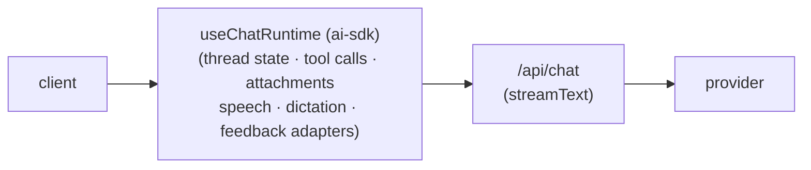

import { VercelIcon } from "@/components/icons/vercel";

[Vercel AI SDK](https://ai-sdk.dev/) is the most common framework people pair with assistant-ui. This page shows where it fits and when to pick it; the setup, attachments, persistence, tool-call patterns, and version notes are under [AI SDK runtime](/docs/runtimes/ai-sdk/overview).

<Callout type="info">
To wire up your first chat, start with the [AI SDK v7 quickstart](/docs/runtimes/ai-sdk/v7).
</Callout>

## Where it slots in

`@assistant-ui/ai-sdk` wraps the AI SDK's `useChat` hook and exposes it as an assistant-ui runtime. The runtime owns conversation state on the client; your `/api/chat` route returns a UI message stream from `streamText`. Everything else (tools, attachments, observability, gateways, custom persistence) layers on top of this base.

## Pick a version

`@assistant-ui/ai-sdk` targets AI SDK v7 and needs `ai@^7.0.101`. New projects start there.

A project on an older AI SDK major stays on an older assistant-ui package: v6 and v5 pin the last `@assistant-ui/react-ai-sdk` release built for their major, and v4 uses `@assistant-ui/react-data-stream`. The [runtime overview](/docs/runtimes/ai-sdk/overview#pick-a-version) lists the package for each major and links its guide.

## When to pick AI SDK

AI SDK is the default choice for new projects on Next.js, Remix, or any framework with a Node-compatible API route. Pick it when:

- You want a single direct path from the chat UI to your model with the smallest possible code surface.
- You will compose with a framework like [Mastra](/docs/runtimes/mastra), an [observability tool](/docs/integrations/observability/langfuse), an [LLM gateway](/docs/integrations/gateways), or [tools through MCP](/docs/tools/mcp), all of which assume an AI SDK route.
- You want first-party `frontendTools`, attachments, multi-step tool calls, token-usage metadata, and persisted history via `withFormat`.

If you need streaming agent state (subgraph events, generative UI messages), look at [LangGraph](/docs/runtimes/langgraph/overview) instead. If you have a different protocol-shaped backend (A2A, AG-UI, OpenCode), see [pick a runtime](/docs/runtimes/pick-a-runtime).

## Related

<Cards>
  <PlatformOnly platforms={["react"]}>
    <Card
      title="OpenAI Agents SDK"
      description="Connect a streamed Agents SDK run to the same AI SDK runtime."
      href="/docs/runtimes/openai-agents"
    />
  </PlatformOnly>
  <Card
    icon={<VercelIcon width={20} height={20} />}
    title="AI SDK runtime overview"
    description="The full runtime documentation and version selector."
    href="/docs/runtimes/ai-sdk/overview"
  />
  <Card
    title="Pick a runtime"
    description="Decision guide if you're not sure AI SDK is the right runtime."
    href="/docs/runtimes/pick-a-runtime"
  />
  <Card
    title="Mastra"
    description="Another framework integration in this section. Wired through AI SDK."
    href="/docs/runtimes/mastra"
  />
</Cards>
