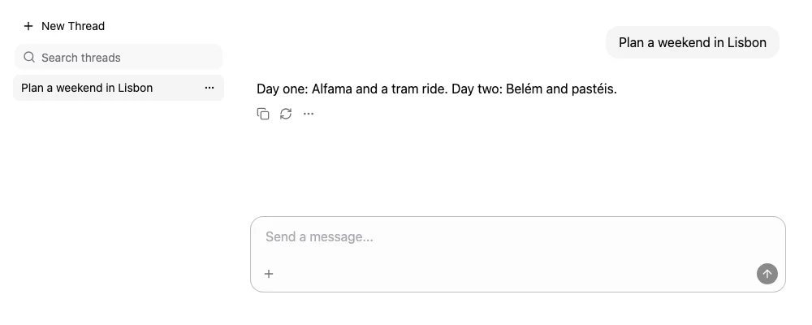

Your users expect their conversations to be there tomorrow, and you may need the data in your own database for compliance, search or analytics. This recipe stores every thread and message in SQLite through four small API routes, and adds a thread list sidebar where users can switch, rename, archive and delete threads. The storage code is one small module, so moving to Postgres or another store is a contained change.



```text title="Prompt for your coding agent"
Follow https://www.assistant-ui.com/docs/recipes/chat-history.md to save my assistant-ui threads and messages in my own database.
```

## What it uses

- **[Threads](/docs/runtimes/concepts/threads)**: a thread is one conversation, and the thread list holds them all. The runtime asks your adapter for the list and creates a thread row the first time a new thread gets a message.
- **`RemoteThreadListAdapter`** maps thread list actions (list, create, rename, archive, delete, title) to your API.
- **`ThreadHistoryAdapter`** loads and saves the messages of the open thread. With `useChatRuntime` you implement its `withFormat` variant, which hands you the AI SDK message already encoded for storage. [Adapters](/docs/runtimes/concepts/adapters) lists the other adapter slots.
- **[`useChatRuntime`](/docs/runtimes/ai-sdk/v7)** talks to the chat route, as in a new app.

## The code

The complete app is [`examples/recipe-chat-history`](https://github.com/assistant-ui/assistant-ui/tree/main/examples/recipe-chat-history). Starting from an app made with `npx assistant-ui@latest create`, add the database module and the thread routes, then the adapter and the page. The chat route itself does not change.

The database: two tables, threads and messages. `node:sqlite` ships with Node.js, so there is nothing to install.

```ts title="lib/db.ts"
import { DatabaseSync } from "node:sqlite";

export type ThreadRow = {
  id: string;
  title: string | null;
  status: "regular" | "archived";
};

export type MessageRow = {
  id: string;
  parent_id: string | null;
  format: string;
  content: Record<string, unknown>;
};

let db: DatabaseSync | undefined;

function getDb() {
  if (db) return db;
  db = new DatabaseSync(process.env.DATABASE_PATH ?? "chat.db");
  db.exec(`
    PRAGMA foreign_keys = ON;
    CREATE TABLE IF NOT EXISTS threads (
      id TEXT PRIMARY KEY,
      title TEXT,
      status TEXT NOT NULL DEFAULT 'regular',
      updated_at INTEGER NOT NULL
    );
    CREATE TABLE IF NOT EXISTS messages (
      id TEXT PRIMARY KEY,
      thread_id TEXT NOT NULL REFERENCES threads(id) ON DELETE CASCADE,
      parent_id TEXT,
      format TEXT NOT NULL,
      content TEXT NOT NULL
    );
  `);
  return db;
}

export const threads = {
  list: () =>
    getDb()
      .prepare("SELECT id, title, status FROM threads ORDER BY updated_at DESC")
      .all() as ThreadRow[],

  get: (id: string) =>
    getDb()
      .prepare("SELECT id, title, status FROM threads WHERE id = ?")
      .get(id) as ThreadRow | undefined,

  create: (id: string) => {
    getDb()
      .prepare("INSERT INTO threads (id, updated_at) VALUES (?, ?)")
      .run(id, Date.now());
  },

  update: (
    id: string,
    patch: {
      title?: string | undefined;
      status?: ThreadRow["status"] | undefined;
    },
  ) => {
    getDb()
      .prepare(
        "UPDATE threads SET title = coalesce(?, title), status = coalesce(?, status), updated_at = ? WHERE id = ?",
      )
      .run(patch.title ?? null, patch.status ?? null, Date.now(), id);
  },

  delete: (id: string) => {
    getDb().prepare("DELETE FROM threads WHERE id = ?").run(id);
  },
};

export const messages = {
  // Insertion order is conversation order; the runtime rebuilds branches from parent_id.
  list: (threadId: string): MessageRow[] =>
    (
      getDb()
        .prepare(
          "SELECT id, parent_id, format, content FROM messages WHERE thread_id = ? ORDER BY rowid",
        )
        .all(threadId) as (Omit<MessageRow, "content"> & { content: string })[]
    ).map((row) => ({ ...row, content: JSON.parse(row.content) })),

  // An upsert, because the runtime saves a message again when it changes after its first save.
  save: (threadId: string, message: MessageRow) => {
    getDb()
      .prepare(
        `INSERT INTO messages (id, thread_id, parent_id, format, content) VALUES (?, ?, ?, ?, ?)
         ON CONFLICT (id) DO UPDATE SET format = excluded.format, content = excluded.content`,
      )
      .run(
        message.id,
        threadId,
        message.parent_id,
        message.format,
        JSON.stringify(message.content),
      );
    getDb()
      .prepare("UPDATE threads SET updated_at = ? WHERE id = ?")
      .run(Date.now(), threadId);
  },
};
```

The thread routes. They return what the adapter reads and nothing more:

```ts title="app/api/threads/route.ts"
import { threads } from "@/lib/db";

export async function GET() {
  return Response.json(threads.list());
}

export async function POST() {
  const id = crypto.randomUUID();
  threads.create(id);
  return Response.json({ id });
}
```

```ts title="app/api/threads/[id]/route.ts"
import { z } from "zod";
import { threads } from "@/lib/db";

type Params = { params: Promise<{ id: string }> };

const ThreadPatch = z.object({
  title: z.string().optional(),
  status: z.enum(["regular", "archived"]).optional(),
});

export async function GET(_req: Request, { params }: Params) {
  const thread = threads.get((await params).id);
  if (!thread) return new Response(null, { status: 404 });
  return Response.json(thread);
}

export async function PATCH(req: Request, { params }: Params) {
  threads.update((await params).id, ThreadPatch.parse(await req.json()));
  return new Response(null, { status: 204 });
}

export async function DELETE(_req: Request, { params }: Params) {
  threads.delete((await params).id);
  return new Response(null, { status: 204 });
}
```

```ts title="app/api/threads/[id]/messages/route.ts"
import { z } from "zod";
import { messages, threads } from "@/lib/db";

type Params = { params: Promise<{ id: string }> };

const StoredMessage = z.object({
  id: z.string(),
  parent_id: z.string().nullable(),
  format: z.string(),
  content: z.record(z.string(), z.unknown()),
});

export async function GET(_req: Request, { params }: Params) {
  const { id } = await params;
  if (!threads.get(id)) return new Response(null, { status: 404 });
  return Response.json(messages.list(id));
}

export async function POST(req: Request, { params }: Params) {
  const { id } = await params;
  if (!threads.get(id)) return new Response(null, { status: 404 });
  messages.save(id, StoredMessage.parse(await req.json()));
  return new Response(null, { status: 204 });
}
```

The adapter, which calls those routes from the browser:

```ts title="app/thread-list-adapter.ts"
import {
  useAui,
  type RemoteThreadListAdapter,
  type ThreadHistoryAdapter,
} from "@assistant-ui/react";
import { createAssistantStream } from "assistant-stream";
import { useMemo } from "react";
import type { MessageRow, ThreadRow } from "@/lib/db";

async function api<T = void>(path: string, init?: RequestInit): Promise<T> {
  const res = await fetch(path, {
    ...init,
    headers: { "content-type": "application/json" },
  });
  if (!res.ok)
    throw new Error(`${init?.method ?? "GET"} ${path}: ${res.status}`);
  return res.status === 204 ? (undefined as T) : res.json();
}

const patchThread = (id: string, patch: Partial<ThreadRow>) =>
  api(`/api/threads/${id}`, { method: "PATCH", body: JSON.stringify(patch) });

const toMetadata = (thread: ThreadRow) => ({
  remoteId: thread.id,
  status: thread.status,
  title: thread.title ?? undefined,
});

// Loads and saves the messages of whichever thread is open.
function useThreadAdapters() {
  const aui = useAui();
  const history = useMemo<ThreadHistoryAdapter>(
    () => ({
      // useChatRuntime only calls the withFormat variant below.
      load: async () => ({ messages: [] }),
      append: async () => {},
      withFormat: (format) => {
        const save = async (item: Parameters<typeof format.encode>[0]) => {
          const { remoteId } = await aui.threadListItem.initialize();
          const row: MessageRow = {
            id: format.getId(item.message),
            parent_id: item.parentId,
            format: format.format,
            content: format.encode(item),
          };
          await api(`/api/threads/${remoteId}/messages`, {
            method: "POST",
            body: JSON.stringify(row),
          });
        };
        return {
          async load() {
            const { remoteId } = aui.threadListItem.getState();
            if (!remoteId) return { messages: [] };
            const rows = await api<MessageRow[]>(
              `/api/threads/${remoteId}/messages`,
            );
            return {
              messages: rows.map((row) =>
                format.decode(row as Parameters<typeof format.decode>[0]),
              ),
            };
          },
          append: save,
          update: save,
        };
      },
    }),
    [aui],
  );
  return useMemo(() => ({ history }), [history]);
}

export const threadListAdapter: RemoteThreadListAdapter = {
  async list() {
    const rows = await api<ThreadRow[]>("/api/threads");
    return { threads: rows.map(toMetadata) };
  },
  async initialize() {
    const { id } = await api<{ id: string }>("/api/threads", {
      method: "POST",
    });
    return { remoteId: id };
  },
  async fetch(remoteId) {
    return toMetadata(await api<ThreadRow>(`/api/threads/${remoteId}`));
  },
  rename: (remoteId, title) => patchThread(remoteId, { title }),
  archive: (remoteId) => patchThread(remoteId, { status: "archived" }),
  unarchive: (remoteId) => patchThread(remoteId, { status: "regular" }),
  delete: (remoteId) => api(`/api/threads/${remoteId}`, { method: "DELETE" }),
  // Titles the thread with the start of its first message; call a model here for smarter titles.
  async generateTitle(remoteId, messages) {
    const first = messages[0]?.content.find((part) => part.type === "text");
    const title = (first?.type === "text" ? first.text : "New chat").slice(
      0,
      60,
    );
    await patchThread(remoteId, { title });
    return createAssistantStream((controller) => {
      controller.appendText(title);
    });
  },
  unstable_useAdapters: useThreadAdapters,
};
```

The page wraps `useChatRuntime` in `useRemoteThreadListRuntime`, so each thread gets its own chat runtime:

```tsx title="app/page.tsx"
"use client";

import {
  AssistantRuntimeProvider,
  useRemoteThreadListRuntime,
} from "@assistant-ui/react";
import { useChatRuntime } from "@assistant-ui/ai-sdk";
import { Thread } from "@/components/assistant-ui/elements/thread.aui";
import { ThreadList } from "@/components/assistant-ui/elements/thread-list.aui";
import { threadListAdapter } from "./thread-list-adapter";

export default function Home() {
  const runtime = useRemoteThreadListRuntime({
    runtimeHook: () => useChatRuntime(),
    adapter: threadListAdapter,
  });

  return (
    <AssistantRuntimeProvider runtime={runtime}>
      <main className="grid h-dvh grid-cols-[260px_1fr] gap-4 p-4">
        <ThreadList />
        <Thread />
      </main>
    </AssistantRuntimeProvider>
  );
}
```

## How it works

- The runtime calls `list()` to fill the sidebar. A new thread exists only in the browser until its first message; then the history adapter calls `aui.threadListItem.initialize()`, which calls your `initialize()` and returns the new `remoteId`. Always await it before you write a message, or the first message races the thread row.
- `withFormat` receives a format adapter. Store `format.format`, `format.getId(message)`, `item.parentId` and `format.encode(item)` as they are, and pass the row back through `format.decode` on load. With `useChatRuntime` the format string is `"ai-sdk/v6"`, also on AI SDK v7; never rename it, or stored history stops loading.
- `parent_id` records the message tree, so edits and regenerations come back as branches. Return rows in the order you saved them.
- `update` rewrites a message that changed after it was saved. The runtime uses it to finish an assistant message saved early, for example one paused on a [tool approval](/docs/recipes/tool-approval), so save it as an upsert.
- `generateTitle` runs once the first message settles. This example titles the thread with the start of the first message; call a model there for a summary title.
- `unstable_useAdapters` runs once per open thread. Read `aui.threadListItem` inside each call, not when the hook mounts, and memoize what it returns.
- This example has one user. In your app, add a user id column and filter every query by the signed-in user, as [Custom thread persistence](/docs/integrations/persistence/custom-adapter) does with Postgres and Auth.js.

## Run it

From the repository root:

```bash
pnpm install
pnpm turbo build --filter='recipe-chat-history^...'
OPENAI_API_KEY=sk-... pnpm --filter recipe-chat-history dev
```

The database file is `chat.db` in the example folder; set `DATABASE_PATH` to put it elsewhere. `pnpm --filter recipe-chat-history test` runs the adapter against the routes and an in-memory database.
