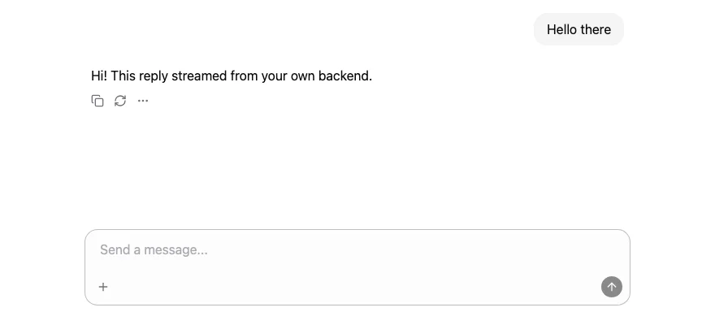

You already have a backend that calls the model, maybe in Python or Go, with its own request and response format. This recipe puts the assistant-ui chat on top of it without changing the backend: you write one adapter that turns the conversation into your backend's request and streams its reply into the thread. Streaming, stop, retry, editing and branching come from assistant-ui.



```text title="Prompt for your coding agent"
Follow https://www.assistant-ui.com/docs/recipes/own-backend.md to connect my assistant-ui chat to my existing backend.
```

## What it uses

- **[The runtime](/docs/concepts/runtime)** holds the conversation and is the only part of the chat that talks to your backend. [LocalRuntime](/docs/runtimes/custom/local-runtime) is the runtime for a backend of your own: it keeps the messages in the browser and calls your adapter once per reply. [Pick a runtime](/docs/runtimes/pick-a-runtime) compares it with the others.
- **`ChatModelAdapter`** is the part you write. Its `run` function gets the conversation and an abort signal, and yields the reply as it streams.
- **[Thread](/elements/thread)** is the chat UI that `npx assistant-ui@latest create` installs.

## The code

The complete app is [`examples/recipe-own-backend`](https://github.com/assistant-ui/assistant-ui/tree/main/examples/recipe-own-backend). Starting from an app made with `npx assistant-ui@latest create`, the adapter and the page are the whole change:

```ts title="app/backend-adapter.ts"
import type { ChatModelAdapter, ThreadMessage } from "@assistant-ui/react";

// Converts assistant-ui messages to the request your backend expects.
const toBackendMessages = (messages: readonly ThreadMessage[]) =>
  messages
    .filter((message) => message.role !== "system")
    .map((message) => ({
      role: message.role,
      text: message.content
        .map((part) => (part.type === "text" ? part.text : ""))
        .join(""),
    }));

export const backendAdapter: ChatModelAdapter = {
  async *run({ messages, abortSignal }) {
    const res = await fetch("/api/backend/chat", {
      method: "POST",
      headers: { "content-type": "application/json" },
      body: JSON.stringify({ messages: toBackendMessages(messages) }),
      signal: abortSignal,
    });
    if (!res.ok || !res.body) throw new Error(`Backend error: ${res.status}`);

    // Each yield replaces the message so far, so yield the whole text each time.
    const reader = res.body.pipeThrough(new TextDecoderStream()).getReader();
    let text = "";
    for (;;) {
      const { done, value } = await reader.read();
      if (done) return;
      text += value;
      yield { content: [{ type: "text", text }] };
    }
  },
};
```

```tsx title="app/page.tsx"
"use client";

import { AssistantRuntimeProvider, useLocalRuntime } from "@assistant-ui/react";
import { Thread } from "@/components/assistant-ui/elements/thread.aui";
import { backendAdapter } from "./backend-adapter";

export default function Home() {
  const runtime = useLocalRuntime(backendAdapter);

  return (
    <AssistantRuntimeProvider runtime={runtime}>
      <main className="h-dvh">
        <Thread />
      </main>
    </AssistantRuntimeProvider>
  );
}
```

In the example, a Next.js route stands in for your backend. Yours can be any server that streams text over HTTP:

```ts title="app/api/backend/chat/route.ts"
import { openai } from "@ai-sdk/openai";
import { streamText } from "ai";
import { z } from "zod";
import { isAllowedRequestContext } from "../../request-context";

export const maxDuration = 30;

// Stands in for your existing backend: it takes role/text pairs and streams plain text back.
const ChatRequest = z.object({
  messages: z.array(
    z.object({ role: z.enum(["user", "assistant"]), text: z.string() }),
  ),
});

export async function POST(req: Request) {
  if (!isAllowedRequestContext(req)) {
    return Response.json(
      { error: "Cross-origin requests are not allowed." },
      { status: 403 },
    );
  }

  const body = ChatRequest.safeParse(await req.json().catch(() => null));
  if (!body.success) {
    return Response.json({ error: "Invalid request." }, { status: 400 });
  }

  const result = streamText({
    abortSignal: req.signal,
    model: openai("gpt-6-luna"),
    messages: body.data.messages.map(({ role, text }) =>
      role === "user"
        ? { role: "user", content: text }
        : { role: "assistant", content: text },
    ),
  });

  return result.toTextStreamResponse();
}
```

## How it works

- `run` is an async generator. Each `yield` replaces the assistant message so far, so yield the whole text each time, never only the new chunk.
- `messages` is the whole conversation as `ThreadMessage` objects, each with a `role` and a list of `content` [parts](/docs/concepts/messages). `toBackendMessages` maps them to the shape your backend reads; change it to match yours.
- Pass `abortSignal` to `fetch`. The stop button aborts it, and the runtime marks the message as cancelled (`status.type` `"incomplete"`, reason `"cancelled"`).
- Throw on a failed request. Any error other than an abort marks the message `"incomplete"` with reason `"error"`, and the user can retry.
- The reply can come in any format `fetch` can read. For newline-delimited JSON, split the decoded text on newlines and parse each line before you yield.
- To stream reasoning or tool calls, yield those part types too; see [Streaming with tool calls](/docs/runtimes/custom/local-runtime#streaming-with-tool-calls).

## Run it

From the repository root:

```bash
pnpm install
pnpm turbo build --filter='recipe-own-backend^...'
OPENAI_API_KEY=sk-... pnpm --filter recipe-own-backend dev
```

`pnpm --filter recipe-own-backend test` runs the adapter against the backend route with a scripted model, so it needs no API key.
