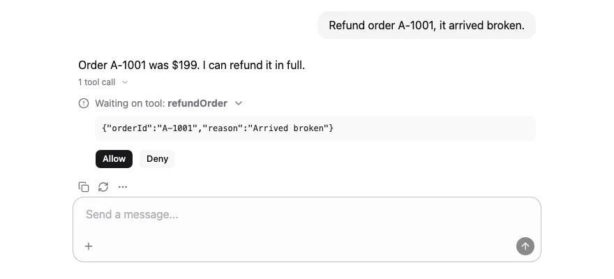

Some tools change things that are hard to undo: refunds, emails, deploys. This recipe builds a support agent that looks up orders on its own but pauses before it refunds one. The chat shows the refund it wants to make with Allow and Deny buttons, and the tool runs only after the user allows it. The server signs each request, so a client cannot forge an approval.



```text title="Prompt for your coding agent"
Follow https://www.assistant-ui.com/docs/recipes/tool-approval.md to make my assistant-ui agent ask before it runs risky tools.
```

## What it uses

- **[Tools](/docs/tools)** defined on the server with the AI SDK's `tool()`. `needsApproval: true` marks the ones that wait for the user; see [Backend tools](/docs/tools/backend).
- **Approval gates**: the server pauses the call and streams an approval request. assistant-ui shows it on the tool-call [part](/docs/concepts/messages) as `approval` and sends the answer back; see [Server-side tool approval](/docs/runtimes/ai-sdk/v7#server-side-tool-approval).
- **[`ToolFallback`](/elements/tool-fallback)**, the default tool card in [Thread](/elements/thread), renders the Allow and Deny buttons, so this recipe needs no UI code.

## The code

The complete app is [`examples/recipe-tool-approval`](https://github.com/assistant-ui/assistant-ui/tree/main/examples/recipe-tool-approval). Starting from an app made with `npx assistant-ui@latest create`, change the chat route and the page:

```ts title="app/api/chat/route.ts"
import { openai } from "@ai-sdk/openai";
import {
  convertToModelMessages,
  stepCountIs,
  streamText,
  tool,
  type UIMessage,
} from "ai";
import { z } from "zod";
import { isAllowedRequestContext } from "../request-context";

export const maxDuration = 30;

const orders: Record<string, { item: string; total: number }> = {
  "A-1001": { item: "Noise-cancelling headphones", total: 199 },
  "A-1002": { item: "USB-C dock", total: 89 },
};

const tools = {
  lookupOrder: tool({
    description: "Look up an order by its id.",
    inputSchema: z.object({ orderId: z.string() }),
    execute: async ({ orderId }) =>
      orders[orderId] ?? { error: `No order ${orderId}` },
  }),
  refundOrder: tool({
    description: "Refund an order in full.",
    inputSchema: z.object({ orderId: z.string(), reason: z.string() }),
    needsApproval: true,
    execute: async ({ orderId }) => {
      const order = orders[orderId];
      if (!order) return { error: `No order ${orderId}` };
      return { refunded: order.total, orderId };
    },
  }),
};

export async function POST(req: Request) {
  if (!isAllowedRequestContext(req)) {
    return Response.json(
      { error: "Cross-origin requests are not allowed." },
      { status: 403 },
    );
  }

  // Signs each approval request, so a client cannot forge an approved call.
  const approvalSecret = process.env.TOOL_APPROVAL_SECRET;
  if (!approvalSecret) throw new Error("Set TOOL_APPROVAL_SECRET.");

  const { messages }: { messages: UIMessage[] } = await req.json();

  const result = streamText({
    abortSignal: req.signal,
    model: openai("gpt-6-luna"),
    system:
      "You are a support agent for an online store. Look up an order before you refund it.",
    messages: await convertToModelMessages(messages, { tools }),
    tools,
    stopWhen: stepCountIs(5),
    experimental_toolApprovalSecret: approvalSecret,
  });

  return result.toUIMessageStreamResponse();
}
```

```tsx title="app/page.tsx"
"use client";

import { AssistantRuntimeProvider } from "@assistant-ui/react";
import { useChatRuntime } from "@assistant-ui/ai-sdk";
import { lastAssistantMessageIsCompleteWithApprovalResponses } from "ai";
import { Thread } from "@/components/assistant-ui/elements/thread.aui";

export default function Home() {
  const runtime = useChatRuntime({
    sendAutomaticallyWhen: lastAssistantMessageIsCompleteWithApprovalResponses,
  });

  return (
    <AssistantRuntimeProvider runtime={runtime}>
      <main className="h-dvh">
        <Thread />
      </main>
    </AssistantRuntimeProvider>
  );
}
```

Set `TOOL_APPROVAL_SECRET` to a long random string, for example from `openssl rand -hex 32`.

## How it works

- The model calls `refundOrder`. Because of `needsApproval`, the server does not run it: it ends the step with the call in state `approval-requested`, and the card shows Allow and Deny.
- The user's answer updates the tool part to `approval-responded`. `lastAssistantMessageIsCompleteWithApprovalResponses` then sends the conversation back, and the server runs the tool if it was allowed, or records it as denied (`output-denied`) and lets the model answer.
- `experimental_toolApprovalSecret` signs each approval request. If a client changes the call's input or invents an approval, the signature check fails and the tool does not run.
- `needsApproval` also takes a function that gets the tool input and returns whether to ask, for example only for refunds above an amount.
- `lookupOrder` has no `needsApproval`, so it runs at once. Mark only the tools whose effects you would want a person to see first.
- For your own approval UI, register a tool UI for the tool and call `respondToApproval`; see [Server-side approval gates](/docs/tools/tool-ui#server-side-approval-gates).
- A pending approval survives a page reload only if the thread's history adapter saves updates; see [Save chat history in your own database](/docs/recipes/chat-history).

## Run it

From the repository root:

```bash
pnpm install
pnpm turbo build --filter='recipe-tool-approval^...'
OPENAI_API_KEY=sk-... TOOL_APPROVAL_SECRET=$(openssl rand -hex 32) pnpm --filter recipe-tool-approval dev
```

Ask it to refund order `A-1001`. `pnpm --filter recipe-tool-approval test` runs the route with a scripted model through request, allow, deny and a forged approval, so it needs no API key.
