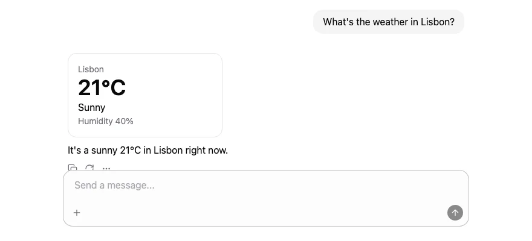

When the model looks something up, a card, chart or table is often a better answer than a paragraph. This recipe gives the model a `getWeather` tool that runs on the server, and renders each call in the thread as a weather card with a loading state while it runs. The same pattern fits any tool: an order status, a flight, search results.



```text title="Prompt for your coding agent"
Follow https://www.assistant-ui.com/docs/recipes/tool-ui.md to render my tool calls as React components in my assistant-ui chat.
```

## What it uses

- **[Tools](/docs/tools)**: a tool is a function the model can call. Each call arrives as a tool-call [part](/docs/concepts/messages) of the assistant message. Here it runs on the server, defined with the AI SDK's `tool()`; see [Backend tools](/docs/tools/backend).
- **[Tool UI](/docs/tools/tool-ui)**: a component that renders a tool call. It gets the call's `args`, its `result` once there is one, and a `status`.
- **Toolkit**: `defineToolkit` names the tools the client knows about. A `type: "backend"` entry has only a `render`, because the server owns the schema and runs the tool. `Tools({ toolkit })` and `AuiConfig` hand it to the runtime.

## The code

The complete app is [`examples/recipe-tool-ui`](https://github.com/assistant-ui/assistant-ui/tree/main/examples/recipe-tool-ui). Starting from an app made with `npx assistant-ui@latest create`, give the chat route a tool:

```ts title="app/api/chat/route.ts"
import { openai } from "@ai-sdk/openai";
import {
  convertToModelMessages,
  stepCountIs,
  streamText,
  tool,
  type UIMessage,
} from "ai";
import { z } from "zod";
import { isAllowedRequestContext } from "../request-context";

export const maxDuration = 30;

const tools = {
  getWeather: tool({
    description: "Get the current weather in a city.",
    inputSchema: z.object({ city: z.string() }),
    // Replace with a call to your weather provider.
    execute: async ({ city }) => ({
      city,
      temperatureC: 21,
      condition: "Sunny",
      humidity: 40,
    }),
  }),
};

export async function POST(req: Request) {
  if (!isAllowedRequestContext(req)) {
    return Response.json(
      { error: "Cross-origin requests are not allowed." },
      { status: 403 },
    );
  }

  const { messages }: { messages: UIMessage[] } = await req.json();

  const result = streamText({
    abortSignal: req.signal,
    model: openai("gpt-6-luna"),
    messages: await convertToModelMessages(messages, { tools }),
    tools,
    stopWhen: stepCountIs(5),
  });

  return result.toUIMessageStreamResponse();
}
```

Write the component:

```tsx title="app/weather-card.tsx"
import type { ToolCallMessagePartComponent } from "@assistant-ui/react";

type WeatherArgs = { city: string };

type Weather = {
  city: string;
  temperatureC: number;
  condition: string;
  humidity: number;
};

export const WeatherCard: ToolCallMessagePartComponent<
  WeatherArgs,
  Weather
> = ({ args, result, status }) => {
  if (status.type === "incomplete") {
    return <p className="text-destructive">Couldn't get the weather.</p>;
  }
  if (result === undefined) {
    return (
      <p className="text-muted-foreground">
        Checking the weather in {args.city ?? "…"}
      </p>
    );
  }
  return (
    <div className="bg-card my-2 w-64 rounded-xl border p-4">
      <p className="text-muted-foreground text-sm">{result.city}</p>
      <p className="text-4xl font-semibold">{result.temperatureC}°C</p>
      <p>{result.condition}</p>
      <p className="text-muted-foreground text-sm">
        Humidity {result.humidity}%
      </p>
    </div>
  );
};
```

Register it under the same name as the server tool:

```tsx title="app/page.tsx"
"use client";

import {
  AssistantRuntimeProvider,
  AuiConfig,
  defineToolkit,
  Tools,
} from "@assistant-ui/react";
import { useChatRuntime } from "@assistant-ui/ai-sdk";
import { Thread } from "@/components/assistant-ui/elements/thread.aui";
import { WeatherCard } from "./weather-card";

// The server runs getWeather; the client only renders its call and result.
const toolkit = defineToolkit({
  getWeather: {
    type: "backend",
    display: "standalone",
    render: WeatherCard,
  },
});

export default function Home() {
  const runtime = useChatRuntime();
  const config = AuiConfig({ tools: Tools({ toolkit }) });

  return (
    <AssistantRuntimeProvider runtime={runtime} config={config}>
      <main className="h-dvh">
        <Thread />
      </main>
    </AssistantRuntimeProvider>
  );
}
```

## How it works

- The toolkit key (`getWeather`) must match the key in the route's `tools`. A tool call with no matching entry falls back to the default tool card.
- `status.type` is `"running"` while the tool runs and `"complete"` once the result is in. `"incomplete"` means it failed or was cancelled. `result` stays `undefined` until the server returns.
- `args` fill in while the model writes the call, so treat every field as possibly missing until the result arrives.
- `display: "standalone"` shows the card on its own. Without it, backend tool calls fold into a collapsed "tool call" group.
- `stopWhen: stepCountIs(5)` lets the model answer in text after the tool returns. Without a stop condition the AI SDK runs a single step and ends at the tool result.
- For a tool that runs in the browser instead, because it needs the user's location or local state, see [Defining tools](/docs/tools/defining-tools).
- To let the model compose its own UI from a set of components, rather than one component per tool, see [Generative UI](/docs/tools/generative-ui).

## Run it

From the repository root:

```bash
pnpm install
pnpm turbo build --filter='recipe-tool-ui^...'
OPENAI_API_KEY=sk-... pnpm --filter recipe-tool-ui dev
```

`pnpm --filter recipe-tool-ui test` runs the route with a scripted model and renders the card in each state, so it needs no API key.
