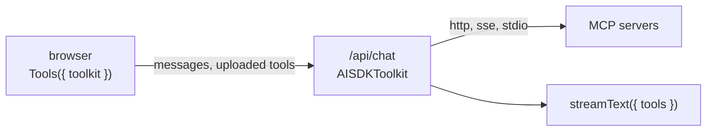

[MCP](https://modelcontextprotocol.io/) is an open protocol for exposing tools, resources, and prompts to LLMs. One MCP server can publish many tools (file system, GitHub, Slack, your own service). This page covers MCP servers that **you** pick: your API route connects to them and hands their tools to the model.

<AgentSetup product="guides/mcp" />

## Which MCP page do I need?

| You want to | Read | The MCP client runs in |
| --- | --- | --- |
| Give the model tools from MCP servers you choose | This page | Your API route |
| Let end users add and sign in to their own MCP servers | [User-managed MCP](/docs/tools/user-managed-mcp) | The browser |
| Show an MCP tool's `ui://` widget inline in the thread | [MCP Apps](/docs/tools/mcp-apps) | A sandboxed iframe, with data from your route |
| Let the user's browser agent call your app's tools | [WebMCP](/docs/tools/webmcp) | Not an MCP client: your page is the server |

## How it works



- `defineMcpToolkit` creates toolkit entries with `type: "mcp"`. An entry holds only the server config, so you declare it on the server and the URL and headers never reach the browser.
- On the route, `AISDKToolkit` connects to each server with `@ai-sdk/mcp`, lists its tools, and merges them with your provider tools, toolkit tools, and the tools uploaded by the browser. MCP tools run on the server.
- The model's calls arrive in the browser as ordinary backend tool calls, which render with `ToolFallback` or a renderer keyed by name. The browser never uploads MCP tools and runs none of them. If you do declare `type: "mcp"` entries in a toolkit the browser imports, `Tools({ toolkit })` skips them.

`@ai-sdk/mcp` ships as a dependency of `@assistant-ui/ai-sdk`, so this path needs no extra install.

## Setup

<Steps>
<Step>

### Declare the servers

Put `defineMcpToolkit({ ... })` in a plain module that only route handlers import. It holds one entry per server. The entry key names the connection and appears in error messages. The server publishes the tool names.

```ts title="app/mcp-toolkit.ts"
import { defineMcpToolkit } from "@assistant-ui/react";

export const mcpToolkit = defineMcpToolkit({
  github: {
    type: "http",
    url: process.env.GITHUB_MCP_URL!,
    headers: { Authorization: `Bearer ${process.env.GITHUB_MCP_TOKEN}` },
    connectionTimeout: 10_000,
  },
});
```

Only the route imports this file, so the URL and token stay out of the browser bundle. Read them from server-only environment variables. A server config takes these fields:

| Transport | Fields |
| --- | --- |
| `http` (Streamable HTTP, recommended) or `sse` (legacy) | `url`, `headers`, `redirect`, `connectionTimeout` |
| `stdio` (a local subprocess; Node, Bun, or Deno only) | `command`, `args`, `env`, `cwd`, `connectionTimeout` |

`connectionTimeout` is in milliseconds and covers creating the client plus listing its tools, so a bad URL or a hung process fails the request instead of stalling it. `redirect` is `"error"` by default, which rejects HTTP redirects; set `"follow"` only for servers you trust.

</Step>
<Step>

### Connect in the route

Wrap the toolkit in an `AISDKToolkit`, pass the browser's uploaded `tools` as `frontend`, and close the connections when the response ends:

```ts title="app/api/chat/route.ts"
import { AISDKToolkit, type FrontendTools } from "@assistant-ui/ai-sdk";
import { openai } from "@ai-sdk/openai";
import { streamText, convertToModelMessages, stepCountIs } from "ai";
import type { UIMessage } from "ai";
import { mcpToolkit } from "../../mcp-toolkit";

export async function POST(req: Request) {
  const {
    messages,
    tools,
  }: { messages: UIMessage[]; tools?: FrontendTools } = await req.json();

  // Built per request and closed below; see "Connection lifecycle" for a shared one.
  const aiToolkit = new AISDKToolkit({ toolkit: mcpToolkit });

  try {
    const aiSDKTools = await aiToolkit.tools({ frontend: tools ?? {} });

    const result = streamText({
      abortSignal: req.signal,
      model: openai("gpt-6-luna"),
      messages: await convertToModelMessages(messages, { tools: aiSDKTools }),
      tools: aiSDKTools,
      stopWhen: stepCountIs(10),
      onFinish: () => aiToolkit.close(),
      onAbort: () => aiToolkit.close(),
    });

    return result.toUIMessageStreamResponse();
  } catch (error) {
    await aiToolkit.close().catch(() => {});
    throw error;
  }
}
```

`stopWhen` lets the model read an MCP result and answer. Without it the AI SDK stops after one step, so the tool runs and the assistant says nothing; see [Multi-step tool calls](/docs/tools/backend#multi-step-tool-calls). The toolkit is built inside the handler, so each request opens its own connections and `close()` ends them. [Connection lifecycle](#connection-lifecycle) covers the alternative of one toolkit at module scope.

To expose your own tools next to the MCP ones, import your `"use generative"` toolkit and merge: `new AISDKToolkit({ toolkit: { ...toolkit, ...mcpToolkit } })`. See [Backend tools](/docs/tools/backend) for the rest of the route (request body, browser tools, multi-modal results).

</Step>
<Step>

### Render the calls

With no setup, `ToolFallback` shows each call's name, arguments, and result. To render one tool yourself, add a render-only entry whose key is the **model-visible** tool name (the MCP tool name with any `prefix` in front):

```tsx title="app/toolkit.tsx"
"use generative";

import { defineToolkit, externalTool } from "@assistant-ui/react";

type Args = { repo: string; number: number };
type Result = { title: string; url: string };

export default defineToolkit({
  get_issue: {
    execute: externalTool(),
    render: ({ args, result }: { args: Args; result?: Result }) => (
      <div className="rounded border p-3">
        <div className="font-mono text-sm">
          {args.repo}#{args.number}
        </div>
        {result && <a href={result.url}>{result.title}</a>}
      </div>
    ),
  },
});
```

`externalTool()` tells the compiler the server owns this tool, so the entry exists only in the browser build and no server-side name conflict arises. The route does not import this file for it. Mount the toolkit with `Tools` as described in [Registering a toolkit](/docs/tools/defining-tools#registering-a-toolkit-with-tools); renderer props, status states, and approvals are covered in [Tool UI](/docs/tools/tool-ui). React Native and Ink use the same keys with a render-only `{ type: "backend", render }` entry.

</Step>
</Steps>

## Declare the servers in a toolkit file

Instead of a separate module, you can spread `defineMcpToolkit({ ... })` into a `"use generative"` toolkit, so the servers sit next to your tools and the route imports one toolkit:

```tsx title="app/toolkit.tsx"
"use generative";

import { defineMcpToolkit, defineToolkit } from "@assistant-ui/react";

export default defineToolkit({
  ...defineMcpToolkit({
    docs: { type: "http", url: "https://docs.example.com/mcp" },
  }),
  // ...your own tools
});
```

The route then passes that toolkit to `AISDKToolkit` directly. For an MCP-only toolkit, export `defineMcpToolkit({ ... })` as the default.

<Callout type="warn">
  A `"use generative"` file is also compiled into your browser bundle, and the client build keeps `defineMcpToolkit(...)` as written, headers and `env` included. Use this form only for servers whose config holds no secret. Otherwise declare them on the server as in the steps above.
</Callout>

## Choose which tools the model sees

Wrap an entry as `{ server, prefix, disabled, tools }` to control what it exposes:

```tsx
defineMcpToolkit({
  docs: {
    server: { type: "http", url: "https://docs.example.com/mcp" },
    prefix: "docs_",
    tools: { delete_document: { disabled: true } },
  },
  github: {
    server: { type: "http", url: "https://github.example.com/mcp" },
    prefix: "github_",
    disabled: !process.env.GITHUB_MCP_URL,
  },
});
```

| Option | Effect |
| --- | --- |
| `prefix` | Prepended as-is to every tool name from this server (`docs_` + `search` is `docs_search`). Add your own separator. |
| `disabled` | Skips the whole server: `AISDKToolkit` does not connect to it. |
| `tools` | Hides individual tools. Keys are the **original** MCP tool names, before the prefix. |

`tools` is a denylist. A tool the server adds later reaches the model unless you gate it with [approval](#require-approval-for-a-tool).

`defineMcpToolkit` is plain data, so options are fixed when you create it. A toolkit created at module scope cannot vary per request. For a per-request decision (a plan, a feature flag, a user role), create it inside the handler and `close()` it as in the setup route:

```ts
const session = await getSession(req);
const aiToolkit = new AISDKToolkit({
  toolkit: defineMcpToolkit({
    docs: {
      server: { type: "http", url: process.env.DOCS_MCP_URL! },
      disabled: !session.canUseDocs,
      tools: { delete_document: { disabled: !session.canDelete } },
    },
  }),
});
```

## Name collisions

The model sees one flat list of tool names, and `aiToolkit.tools()` refuses to build it when two names match. It rejects the request with an error before `streamText` starts:

- Two MCP servers expose the same name: `MCP tool name collision: "search" is exposed by both "docs" and "github". Rename one of the toolkit entries or expose distinct MCP tool names.`
- An MCP tool matches one of your toolkit, provider, or uploaded browser tools: `MCP tool "search" from "docs" conflicts with toolkit tool "search". Rename one of the tools so each model-visible tool name is unique.`

Give each server a `prefix`, so `docs_search` and `github_search` stay distinct. Names are compared after the prefix is applied and after `tools` entries are disabled, so a disabled duplicate does not count. Outside `AISDKToolkit` nothing detects collisions: when you spread tool maps from several clients yourself, the later spread silently wins.

User-managed MCP resolves collisions differently, by registering none of the colliding tools; see [Tool names](/docs/tools/user-managed-mcp#tool-names).

## Require approval for a tool

MCP tools run on the server, so approval is a server-side gate, not a `humanTool()`. Set AI SDK v7's call-level `toolApproval` on `streamText`, keyed by the model-visible name (prefix included):

```ts
const result = streamText({
  // ...
  tools: aiSDKTools,
  toolApproval: { github_delete_repository: "user-approval" },
});
```

The call then arrives in the browser with `approval` and `respondToApproval`, which the default `ToolFallback` and your own renderers handle like any other backend tool. The client wiring (`sendAutomaticallyWhen`) is in [Server-side tool approval](/docs/runtimes/ai-sdk/v7#server-side-tool-approval), and the renderer API is in [Tool approvals](/docs/tools/tool-approvals#server-side-approval-gates). Servers that end users connect themselves use a different mechanism; see [Tool approvals](/docs/tools/user-managed-mcp#tool-approvals).

## Connection lifecycle

`AISDKToolkit` opens one client per `defineMcpToolkit` entry, on the first `tools()` call for that entry.

- **Per request** (the setup route): construct the `AISDKToolkit` in the handler and call `close()` in `onFinish`, `onAbort`, and the `catch`. `onFinish` runs after the stream completes, so connections stay open while the model keeps calling tools; a cancelled request runs `onAbort` instead. This fits serverless.
- **Shared**: construct it once at module scope, as [Backend tools](/docs/tools/backend) does, and never call `close()` per request. Clients stay open and are reused, and each `tools()` call re-lists the tools. A client that fails to connect or times out is dropped, so the next call retries it. A client whose connection drops after it connected is not: every later `tools()` call throws `MCP toolkit entry "<name>" failed to list tools: …` until you call `close()`, after which the next call reconnects. This fits a long-lived Node server.
```ts
const aiToolkit = new AISDKToolkit({ toolkit: mcpToolkit });

export async function POST(req: Request) {
  // ...
  const aiSDKTools = await aiToolkit.tools({ frontend: tools ?? {} });
  // pass aiSDKTools to streamText; no onFinish, onAbort, or catch close
}
```

`close()` closes every client. If some fail, it throws `MCP toolkit entry "github" failed to close: ...`, or an `AggregateError` when several fail.

## Without a toolkit

If the route builds its AI SDK tools by hand, use the MCP client directly. `tools()` returns the same shape as `streamText`'s `tools` argument. `stopWhen` is needed here for the same reason as in the setup route:

```ts title="app/api/chat/route.ts"
import { createMCPClient } from "@ai-sdk/mcp";
import { frontendTools } from "@assistant-ui/ai-sdk";
import { openai } from "@ai-sdk/openai";
import { streamText, convertToModelMessages, stepCountIs } from "ai";

export async function POST(req: Request) {
  const { messages, tools } = await req.json();

  const mcpClient = await createMCPClient({
    transport: {
      type: "http",
      url: process.env.MCP_SERVER_URL!,
      headers: { Authorization: `Bearer ${process.env.MCP_TOKEN}` },
    },
  });

  try {
    const aiSDKTools = { ...frontendTools(tools ?? {}), ...(await mcpClient.tools()) };

    const result = streamText({
      abortSignal: req.signal,
      model: openai("gpt-6-luna"),
      messages: await convertToModelMessages(messages, { tools: aiSDKTools }),
      tools: aiSDKTools,
      stopWhen: stepCountIs(10),
      onFinish: () => mcpClient.close(),
      onAbort: () => mcpClient.close(),
    });

    return result.toUIMessageStreamResponse();
  } catch (error) {
    await mcpClient.close().catch(() => {});
    throw error;
  }
}
```

For stdio here, install `@modelcontextprotocol/sdk` and pass `new StdioClientTransport({ command, args })` as the `transport`. The MCP client uses Node APIs, so keep it server-side.

If your server calls `sampling/createMessage`, assistant-cloud users can trace it with [`wrapSamplingHandler`](/docs/cloud/traces) and [`createSamplingCollector`](/docs/cloud/traces).

## Security

- **Tool descriptions and results are untrusted input.** A server controls the text the model reads for each tool and each result, so a compromised or malicious server can try to steer the model. Connect only servers you trust, and gate tools with side effects behind [approval](#require-approval-for-a-tool).
- **Credentials stay on the server.** Keep tokens in server-only environment variables and out of any file the browser bundles (see [the toolkit file variation](#declare-the-servers-in-a-toolkit-file)).
- **stdio runs a process with your route's privileges.** Spawn only commands you wrote, and never build `command` or `args` from user input.
- **The browser's `tools` and `system` are untrusted.** See [Treat the body as untrusted](/docs/tools/backend#treat-the-body-as-untrusted).

## Troubleshooting

| Error or symptom | Cause and fix |
| --- | --- |
| `MCP toolkit entry "github" failed to connect: ...` | The URL, transport `type`, or credentials are wrong. The message carries the underlying error. |
| `MCP toolkit entry "github" failed to list tools: ...` | The connection opened but `tools/list` failed. Check the server's logs. |
| `MCP toolkit entry "github" timed out while connecting after 10000ms.` | The server did not answer within `connectionTimeout`. The phase reads `listing tools` when listing is the slow step. |
| `MCP tool name collision: ...` or `MCP tool "x" from "y" conflicts with ...` | Two tools share a model-visible name. Add a `prefix`; see [Name collisions](#name-collisions). |
| `MCP toolkit entry "github" requires AISDKToolkit.` | The route calls the deprecated `generativeTools()`. Use `new AISDKToolkit({ toolkit }).tools(...)`. |
| `stdio MCP transport requires a runtime that can spawn a subprocess` | A `stdio` entry loaded in an edge, worker, or browser runtime. Use an `http` server, or run the route on Node. |
| The assistant runs an MCP tool, then says nothing | The route has no `stopWhen`, so the AI SDK stops after the first step. Add `stopWhen: stepCountIs(10)`; see [Multi-step tool calls](/docs/tools/backend#multi-step-tool-calls). |
| The model never calls the tools | The route does not return `await aiToolkit.tools(...)` to `streamText`, the entry is `disabled`, or the tool is hidden by `tools`. |
| Calls show but your renderer does not | The renderer key is not the model-visible name. With a `prefix`, key it `docs_search`, not `search`. |
| Connections pile up | A per-request toolkit is missing `close()` in `onFinish`, `onAbort`, or the `catch`. |
